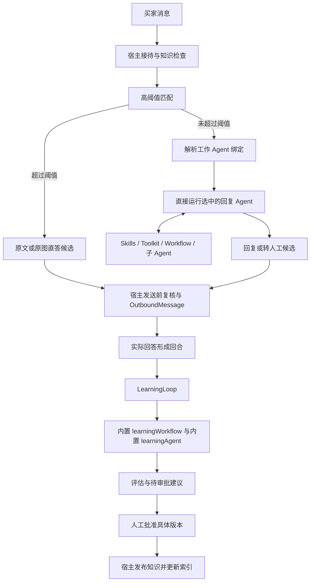

# Agent 配置与高级扩展

版本：v0.9  
方案日期：2026-09-08  
Agent 发布交互已于 2026-09-10 简化，当前规则见 [Agent 发布与店铺应用](agent-publication.md)。

状态：已提供拼多多首版实现；实际交付、验证证据与待实测项见[实现与验证记录](implementation-status.md)。

## 1. 产品定位与参考范围

JuDesk 提供本地 Agent 配置台（Agent Studio），**只用于自动回复编排**，并且 **默认不出现在侧栏**。只有设置里打开开发者模式后，才能看到定制 Agent、Skills、Toolkit、Workflow、子 Agent 和工作绑定页。关闭开发者模式只隐藏入口，不删除已有资产，也不自动改回默认 Agent。

首次使用时平台写入一个预置的默认自动回复 Agent，并绑为全局回复。该默认 Agent **可以删除**。删除后若再无有效回复绑定，未过直答阈值的消息不再调用 Agent。关闭开发者模式或重启都不会偷偷重建。用户可 **一键加回** 默认 Agent：按当前产品模板新建一份默认资产，并重新设为全局回复绑定；已有店铺覆盖保持不变。

未开开发者模式的日常接待使用当前绑定（通常就是这个默认 Agent）和问答库，不必进入配置台。问答库的导入、编辑（含意图-图片）始终可见。默认 Agent 缺失时，设置页仍提供一键加回，不必先打开整套定制模块。

自动学习不走这套编排。产品内置 `learningAgent` 与 `learningWorkflow`，用户可以开 / 关学习和选择学习模型，不能新建、复制、挂载或替换学习 Agent。回复和学习均不设每日调用次数上限。

根据“单机用户”的定位，本方案不引入组织、成员、组织管理员、团队工作区、多租户鉴权或对外 AppKey。所有配置属于当前本地资料库；店铺与账号继续用于隔离客服业务数据。资源命名空间只用于避免重名，不代表组织。以后如果增加多人协作，再单独设计用户与权限体系。

### 1.1 agent-platform 中已核对的设计

| 参考实现                                                                                                                                                   | 本次读到的能力                                                                     | JuDesk 的采用方式                                                           |
| ---------------------------------------------------------------------------------------------------------------------------------------------------------- | ---------------------------------------------------------------------------------- | --------------------------------------------------------------------------- |
| [共享配置模型](../../agent-platform/packages/shared/src/index.ts)                                                                                          | Agent 的 prompt、modelId、memory、toolkitIds、workflowIds；草稿与发布修订分离      | 保留配置与修订模型，仅用于回复角色；增加子 Agent 挂载及本地绑定             |
| [Agent Studio](../../agent-platform/apps/web/src/features/agent-studio/studio.tsx)                                                                         | 配置编辑、资源挂载、调试界面                                                       | 改为 Electron 内的本地配置台                                                |
| [Agent 服务](../../agent-platform/apps/api/src/agents/service.ts)                                                                                          | 草稿 revision 校验、发布快照、历史版本与恢复                                       | 保留乐观锁和不可变发布版本；发布与设为工作 Agent 分开                       |
| [资源目录与工厂](../../agent-platform/apps/api/src/assets/catalog.ts)                                                                                      | Toolkit / Workflow 集合声明、设置字段、createTools / createWorkflows、成员 ID 校验 | 保留集合与成员接口，改成本地扩展目录与受控宿主上下文                        |
| [Toolkit 示例](../../agent-platform/toolkits/platform/utilities/index.ts)与[Workflow 示例](../../agent-platform/workflows/platform/morning-brief/index.ts) | 一个集合包含多个工具或原生 Mastra Workflow；输入与输出 schema 独立声明             | 提供同类 TypeScript SDK、模板、成员测试和集合挂载能力                       |
| [运行时装配](../../agent-platform/apps/api/src/runtime/service.ts)                                                                                         | 按草稿或发布配置构建 Agent，展开挂载集合                                           | 在本地 utilityProcess 装配，通过 IPC 使用；不照搬 Hono 服务和服务端身份体系 |
| [数据库模型](../../agent-platform/apps/api/prisma/schema.prisma)与[工作区设计](../../agent-platform/docs/workspaces.md)                                    | 组织、个人 / 团队工作区、组织设置、AppKey 与运行归属                               | 省去组织形态，保留配置版本、设置来源和运行追踪；买家 Memory 必须单独隔离    |

参考项目的 toolkitIds / workflowIds 指向集合资产，不是单个工具或单条流程；挂载集合后展开其中的成员，每个 Workflow 成员可以单独调用。集合 settings 与每次调用的业务 input 分开，这两个层次都保留。

本次参考不意味着整套服务端运行时可以直接移植。参考项目运行时仍会读取当前工具工厂及设置，不能据此宣称它已经冻结了所有代码依赖。下文要求的扩展产物哈希、回复工作绑定、子 Agent 闭包、发送前配置复核和强制人工知识审批，是 JuDesk 自己的设计约束。参考实现使用 AgentController 等运行设施；JuDesk 是否需要这些 API，由锁定版本的 M0 验证决定。

### 1.2 首版范围

| 能力                                                    | 首版安排                                                          |
| ------------------------------------------------------- | ----------------------------------------------------------------- |
| 开发者模式开关与定制模块显隐                            | 必须交付；默认关闭，关闭时看不到 Agent Studio                     |
| 预置默认可删除的自动回复 Agent                          | 必须交付；删除后不自动重建，提供一键加回                          |
| 多套回复 Agent、草稿 / 调试 / 发布 / 历史恢复           | 必须交付，仅用于自动回复，且仅开发者模式可见                      |
| 全局默认与店铺专用的回复 Agent                          | 必须交付，绑定页仅开发者模式可见                                  |
| 子 Agent 挂载                                           | 必须交付：回复 Agent 可挂载其他已发布回复 Agent，运行时按别名调用 |
| Toolkit / Workflow 集合、成员 schema、配置、试跑、挂载  | 必须交付，是高级用户接口，仅可挂到回复 Agent                      |
| Skills 技能库、Markdown / 资料 / 脚本编辑、挂载与版本快照 | 已交付，回复 Agent 按需加载并通过 runSkillScript 执行脚本，编辑器支持直接试运行；详细见 [Skills 技能库](skills.md) |
| TypeScript 扩展 SDK、本地构建安装、不可变版本及依赖检查 | 必须交付，先支持受信任的本地扩展                                  |
| Workflow 调用                                         | 统一挂载给回复 Agent，由 Agent 按需调用；工作绑定只选择 Agent      |
| 学习 Agent / 学习策略入口                               | 产品内置，不在配置台搭建、绑定或替换                              |
| MCP、可视化流程画布、扩展市场                   | 后续能力                                                          |

## 2. Agent 定义、发布与设为工作 Agent

Agent 是可保存的 **自动回复** 配置资产。`replyAgent` 是工作角色名称，指向用户选定 Agent 的当前发布配置；`learningAgent` 是产品内置实例，不是配置台里的可编辑资产。

创建资料库时写入 `origin = builtin_default` 的“默认自动回复”Agent，并设为全局回复绑定。它与学习 Agent 不同：默认回复 Agent 是可删除的业务资产，不是锁死的系统进程。删除前展示当前绑定；若它仍是某店或全局的工作 Agent，删除同时解除这些绑定。历史运行记录仍能指向已删修订。

一键加回调用 `restoreBuiltinDefaultReplyAgent`：按当前安装包内的默认模板新建 AgentDefinition / 发布修订，`origin` 仍为 `builtin_default`，并写入全局回复绑定。不加回已删除记录的原 ID，不覆盖仍有效的店铺专用绑定，不自动打开开发者模式。若资料库里已有未删除的默认 Agent，该操作只确保它被绑为全局回复，不复制第二份。产品升级后的模板变化只影响下一次加回，不原地改写用户已改过的默认 Agent。

停用或删除其他用户 Agent 前展示全局 / 店铺绑定、子 Agent 引用和未完成任务；被使用的修订和扩展产物保留。用户需先更换绑定或接受“无 Agent、仅直答”的降级。修改模板不会修改已复制的 Agent。

| 配置项             | 约定                                                                |
| ------------------ | ------------------------------------------------------------------- |
| 基础资料           | 名称、说明；角色固定为自动回复，首版使用统一默认图标                          |
| 指令               | 可编辑提示词；运行时在用户指令之外注入角色契约和业务上下文          |
| 模型               | 选择 ModelProfile；发布时保存模型与参数快照，密钥只保存 secretRef   |
| Skills | 独立技能库；草稿保存 skillIds，发布冻结完整正文、参考文件与脚本，运行时按需加载 / 执行 |
| Toolkit / Workflow | Toolkit 选择工具包并自动跟随最新启用版本；Workflow 选择确切版本，查看成员、schema 和所需能力 |
| 子 Agent           | 选择已发布回复 Agent 与调用别名；每轮解析当前发布配置，禁止环路 |
| Memory             | 配置近期消息数量与 working memory；宿主强制店铺 / 会话隔离    |
| 执行限制           | 超时、最大步骤、输入 / 输出、Workflow / 子 Agent 嵌套深度和调用预算 |
| 角色兼容           | 发布前只校验 reply 契约；配置台资产不得声明 learning 角色           |

生命周期：创建 / 复制 → 编辑草稿 → 调试 → 发布。首次使用时按名称选择全局默认或店铺专用 Agent，后续发布自动更新所有已有使用方。草稿自动保存使用内部 draftRevision 乐观锁；冲突保留用户编辑。调试标记为草稿试运行，不显示修订编号。

发布生成不可变 AgentRevision，保存提示词、模型参数、Memory 策略、技能内容与依赖信息，并自动更新所有已有使用方。相同配置重复发布不产生记录。用户只看到未发布、有修改待发布、已发布三种状态；发布记录按时间展示，可恢复为草稿后重新发布。

一个修订只有通过 reply 契约才能绑定为工作回复 Agent，或被其他回复 Agent 挂载为子 Agent。配置台不提供学习角色绑定。修改模板不会修改已复制的 Agent，修改 ModelProfile 的非密钥参数也不会原地改动已发布快照。

### 2.1 创建与编辑交互

参考 agent-platform 的 `create-agent.tsx`、`studio.tsx` 和 `mount-picker.tsx`，采用「轻量创建 → 宽屏编排」的两步交互，保留 JuDesk 本地单用户形态。

- **创建窗口**：只填写名称（必填，最多 80 字符）与说明（选填，最多 1000 字符）。「创建并编排」保存初始草稿并打开编辑器；默认使用已配置的第一个对话模型，无模型时仍可创建草稿，在编辑器中明确提示补充模型。
- **编辑器顶部**：就地编辑名称，展示发布状态、自动保存状态和最近发布时间。只保留一个「发布」按钮；发布记录、复制 / 导出 / 删除归入更多操作。
- **左栏 · 人设与回复逻辑**：选择模型、大面积编辑系统提示词、查看字符数。「记忆与执行」分组设置近期消息数、会话工作记忆、最大步骤和子 Agent 深度。
- **中栏 · 能力配置**：分别展示 Skills、Toolkit、Workflow、子 Agent 已挂载条目，可直接移除。Toolkit 显示「自动跟随最新」及当前启用版本，子 Agent 显示使用已发布配置。添加资源时打开可搜索的选择窗，支持按名称、说明、集合成员查找，确认后应用选择；缺失或停用资源明确标识。子 Agent 按名称选择并填写唯一调用别名，点击已挂载条目可更换助手与别名，无版本选择。说明在「基本信息」中编辑。
- **右栏 · 预览与调试**：输入买家问题后点击「试运行」，先保存最新有效草稿，再调用原有隔离调试接口。以问题 / 回复形式展示结果，附带草稿试运行标识、回复或转人工动作、用量和可展开的完整结果。每次为独立测试场景，界面记录不会当成连续会话传给模型；仅点击试运行才产生模型请求，不增加格式修复或 UI 专用模型调用。
- **底部**：提示草稿与工作绑定的关系，提供工作绑定入口。保存草稿、恢复历史、试运行不改变接待；发布后，所有使用该 Agent 的店铺自动更新。

编辑停止约 900ms 后自动保存有效草稿。请求串行处理，使用最新 `draftRevision`，保存期间的新输入仍会继续写入；保存、发布、复制、导出、试运行等操作等待需要的保存完成。出现版本冲突保留编辑内容并停止后台重试，用户可重试保存或确认重新加载资料库中的草稿。关闭编辑器先完成保存；存在无效或保存失败的修改时，可继续编辑或明确放弃未保存修改。恢复历史版本经过确认后替换当前草稿，允许替换尚未保存的无效草稿。

编辑器三栏独立滚动，顶部和底部操作固定。已适配桌面最小 1120px 宽窗口，不需要滚到长表单末尾才能保存、发布或试运行。

## 3. 工作角色与绑定规则

### 3.1 绑定优先级

| 工作角色 | 是否可编排     | 触发时机                                           | 默认职责                                            |
| -------- | -------------- | -------------------------------------------------- | --------------------------------------------------- |
| reply    | 是，配置台资产 | 自动回复开启且接待资格有效，问答对未超过直答高阈值 | 结合本店知识、挂载工具与子 Agent 生成回答，或转人工 |
| learning | 否，产品内置   | 自动学习开启，新的问题已有实际回答或来源被修正     | 评估匹配、回答质量和可复用性，保存报告与待审批建议  |

只有 reply 进入 AgentBinding。每个资料库配置一个全局默认回复绑定；每个店铺可选择“继承全局”或“使用店铺专用”。有效选择为店铺专用优先、没有覆盖时继承全局。每个店铺同时只有一个有效回复绑定；选中 Agent 不会自动打开自动回复，也不会清除会话转人工等待。学习没有店铺专用 Agent，也不出现在工作绑定列表。

例如全局使用“通用客服”，拼多多 A 店铺单独使用“售后客服”，闲鱼 B 店铺继承全局。重新发布“通用客服”后，B 店自动更新；A 店继续使用售后客服。

绑定界面和 IPC 按 `agentId` 选择助手，内部保存当前发布快照引用与乐观锁。Toolkit 按包名解析最新启用版本，子 Agent 解析当前发布配置；Workflow 使用所选产物，Skill 使用发布内容。宿主直接运行工作 Agent，由 Agent 按需调用已挂载能力；工作绑定不再提供独立的回复策略或 Workflow 入口。界面显示实际回复 Agent 名称、继承来源与配置状态。

显式绑定的修订缺失、子 Agent 缺失、资源禁用或配置不完整时，显示配置错误，不静默改用另一个 Agent。高阈值直答不需要加载回复 Agent；其自身知识、检索与发送条件满足时仍可执行。进入 Agent 路径却无有效回复配置时转人工。内置学习 Agent 随应用版本加载；其模型或规则不可用时保留学习积压并提示修复，不得把无法执行的回合标记为已评估。

### 默认接待与转人工规则（2026-09-08 更新）

默认助手、新手引导和 Studio 新建助手使用同一份接待提示词。运行时与 `handoffToHuman` 工具说明同步采用以下判断：

- 仅有“在吗 / 你好 / 有人吗”等问候，直接简短回应；感谢和确认也可自然回复。不要求知识命中或业务证据，不为寒暄调用检索、业务工具或转人工。
- 信息不完整，先结合已有上下文，仍不明确则追问一个必要问题；不重复索要已有商品、订单资料。检索为空不等于必须转人工。
- 业务事实仍须使用本店有效知识或工具核实；不编造价格、库存、售后政策，不假称完成订单操作。
- 买家明确要求人工、需要人工权限或裁量，或合理查询和澄清后关键业务问题仍无法处理时才转人工。判断完整诉求，“在吗，帮我转人工”仍转人工，“在吗，这款有货吗”需查询或澄清商品。

本次只调整提示词与工具说明，不新增意图分类、格式修复或二次判定模型请求，也不拦截合法的转人工工具调用。运行时仍保留模型/工具故障和实际发送资格检查。

启动时，仅草稿与最新发布配置一致、完整配置仍匹配已知内置默认/引导模板的助手自动生成新修订，更新指向旧最新版的绑定并记录审计。旧修订、历史版本绑定、自定义提示词和未发布草稿保留；新修订沿用已发布的模型快照，不顺带发布模型设置中的未生效编辑。旧默认/Studio 模板在运行时采用修正后的接待规则，自定义提示词仍保留并追加相同的业务依据适用范围说明。

修改提示词不会自动解除已经进入等待人工的会话；仍按现有人工接待流程处理后续消息，不补发旧回答。

### PDD 工具退役与统一目录（2026-09-08）

正常 Toolkit 目录只提供“店铺客服工具”和“基础工具”；旧“拼多多查询 v1”“拼多多客服工具箱 v2”不再注册到新资料库，不出现在资源目录与挂载选择。旧资料库仍保留已有清单与哈希，历史发布记录由兼容层执行。

该迁移与上面的默认提示词升级分别处理：定向替换所有有效 Agent 最新发布配置中的旧 PDD 工具引用，保留自定义提示词、模型快照、执行步数、Skills 和 Workflow。子 Agent 最新版本引用随新修订更新，固定的历史引用保留。草稿独立更新工具引用，不发布其中的待定编辑。仅指向迁移前最新版的工作绑定切到新修订，并保留旧修订与审计。保存/导入/恢复配置统一将旧 PDD ID 转成通用工具并去重。

### 3.2 配置激活与在途工作

草稿自动保存，发布自动更新已有绑定；首次更换工作 Agent 在工作绑定页完成。绑定和生产集合设置在保存生效前校验依赖、reply 兼容性、子 Agent 闭包及必填字段，提交预期 revision 以拒绝过期写入；成功后事务更新配置，并递增受影响店铺的 `replyConfigEpoch`。移除店铺覆盖同样是一次配置切换。学习策略（开关、预算、内置模型引用）变更递增 `learningConfigEpoch`，与回复编排无关。

| 任务阶段                                    | 切换后的处理                                                                                                      |
| ------------------------------------------- | ----------------------------------------------------------------------------------------------------------------- |
| 尚未开始的任务                              | 开始时解析当前有效绑定和设置，创建 RunConfigSnapshot                                                              |
| 生成中或 prepared 的自动回复                | 旧配置结果失去发送资格；取消可取消的调用，仍符合接待条件的未回答消息可按新配置重新规划                            |
| 已 dispatching、confirmed 或 unknown 的发送 | 保留原快照并按原意图对账；切换配置不产生第二个发送意图                                                            |
| 进行中的学习评估                            | 提交报告 / 候选时检查内置学习版本与 learningConfigEpoch；旧执行标记 superseded，当前来源仍有效时用内置 Agent 重排 |
| 已完成评估或已有候选                        | 保留当时内置学习版本和证据；回复编排切换不触发学习重评，也不自动使候选获批                                        |

配置切换与发送提交在同一会话串行控制入口形成明确顺序。提交前复核 epoch；已进入平台的请求可能无法撤回，必须继续追踪。回复意图键仍绑定问题与用途，不加入 Agent 版本或随机 runId 来绕过去重。人工暂停与转人工期间取消的旧问题，不能因为切换配置重新获得回复资格。

角色模型、代码、非密钥设置、策略 Workflow、子 Agent 修订或绑定变化产生新的有效配置指纹。集合设置修改只递增实际受影响的店铺 epoch；仅替换同一 secretRef 的凭据值属于凭据轮换，可供后续调用使用，记录凭据版本但不把明文放入快照。

### 3.3 子 Agent 挂载

回复 Agent 可以挂载其他 **已发布且通过 reply 契约** 的 Agent，按名称选择并设置调用别名。每轮按 Agent 身份解析当前发布配置并固定在本轮快照中；子 Agent 重新发布后无需再发布父助手。旧 `agentRevisionId` 引用兼容解析为原 Agent 身份，绝不按同名匹配其他助手。

| 约定 | 说明                                                                                           |
| ---- | ---------------------------------------------------------------------------------------------- |
| 用途 | 只服务自动回复编排，例如“查商品售后子 Agent”“话术润色子 Agent”                                 |
| 调用 | 宿主提供 `context.agents.runSub(alias, input)`；父 Agent 不接受任意 agentId 或学习角色         |
| 权限 | 子 Agent 沿用或缩小父运行的店铺、会话、账号、剩余预算和已验收能力，不能扩权                    |
| 工具 | 子 Agent 使用自己挂载的 Toolkit / Workflow / 更深层子 Agent，但仍受本轮能力交集约束            |
| 发送 | 子 Agent 若产生待发内容，必须回到父轮的 ReplyCandidate / OutboundMessage，不能自己另开发送意图 |
| 环路 | 发布时做闭包与环路检查；禁止 A→B→A。运行时限制嵌套深度和步数                                   |
| 学习 | 子 Agent 不能被学习循环调用，也不能挂成学习入口                                                |

父 Agent 停用或删除前，须检查是否被其他回复 Agent 挂载。子修订缺失时，父绑定进入可见故障，不跳过该子 Agent 继续自动回复。调试中的子 Agent 调用同样进入隔离宿主，不得写入生产发送或学习队列。

## 4. Toolkit 与 Workflow 资源模型

侧栏 Toolkit 与 Workflow 各自拥有独立资源页、安装入口和列表，按 manifest.kind 筛选。安装时同时校验所选入口的类型，避免把流程装进工具页。底层复用安装产物、设置和成员试跑机制；这不影响二者在界面与 Agent 挂载中的独立性。Skills 的文件资源模型另见 [Skills 技能库](skills.md)。

### 4.1 集合、成员与设置

| 概念 | Toolkit                                  | Workflow                                           |
| ---- | ---------------------------------------- | -------------------------------------------------- |
| 集合 | 一组有关联的工具，如商品查询工具集       | 一组有关联的原生 Mastra Workflow，如售后辅助流程集 |
| 成员 | 一个有输入 / 输出 schema 的工具          | 一条有输入 / 输出 schema 的 Workflow               |
| 工厂 | createTools(context)                     | createWorkflows(context)                           |
| 挂载 | Agent 挂载集合，运行时展开允许的工具成员 | Agent 挂载集合，成员分别注册为可调用流程           |
| 设置 | 集合共用配置、密钥引用与店铺覆盖         | 同左；不把每次订单号、问题文本写成固定配置         |

资产 ID 使用 `builtin/<name>` 或 `local/<name>`，成员完整 ID 为 `<assetId>/<memberId>`。Toolkit 按包名挂载，每轮解析最新启用版本，在运行快照中记录确切版本和 artifactHash；旧的带版本挂载也按包处理。Workflow 发布引用仍固定版本。详见 [Toolkit 自动使用最新版](toolkit-latest.md)。提供者命名空间可以扩展，但不需要 Organization 表。框架或模型要求缩短别名时由宿主生成稳定映射并检测冲突，不直接截断后接受重名。

挂载单位保留集合；调试和调用单位是成员。声明了多个成员，就必须完整返回对应工厂成员；缺失、重复、额外未声明成员、Workflow 原生 ID 不匹配，均使该版本无法启用。输出也需要 schema 校验，不能只验证输入。

集合的 `settingsFields` 包含 key、label、required、secret 和配置 schema。设置按“本地默认 → 店铺覆盖”解析；未覆盖的字段继承默认，显式清空与未设置分开表达。Memory、店铺 / 买家身份不属于可由集合设置覆盖的普通字段。secret 字段在业务库只存系统加密凭据引用，界面和导出不返回原值。

发布固定代码依赖；有效设置单独版本化并在每次运行开始时冻结。修改设置必须经过显式保存生效和角色配置复核，不读取一个未保存的编辑器状态，也不在一次运行中混用新旧非密钥设置。

### 4.2 SDK 契约

提供 `@judesk/extension-sdk`，统一 manifest、设置、成员 schema、宿主上下文、工厂校验和测试工具。下面是计划中的 API 形状，准确类型由 M0 / M1a 对锁定的 Mastra 版本实现；不是当前已经可导入的包。

```ts
import type {
  ExtensionManifest,
  ScopedAssetContext,
  ToolMap,
  WorkflowMap,
} from '@judesk/extension-sdk';

export interface ToolkitModule {
  manifest: ExtensionManifest<'toolkit'>;
  createTools(context: ScopedAssetContext): ToolMap | Promise<ToolMap>;
}

export interface WorkflowModule {
  manifest: ExtensionManifest<'workflow'>;
  createWorkflows(context: ScopedAssetContext): WorkflowMap | Promise<WorkflowMap>;
}
```

manifest 至少包含 apiVersion、assetId、version、kind、name、description、settingsFields、成员列表、成员 inputSchema / outputSchema、requiresCapabilities 和依赖。构建时同时生成静态 manifest.json 供目录读取，加载工厂后校验其声明与静态清单一致。Toolkit 成员声明工具能力；Workflow 成员作为普通 Agent 能力调用，不声明独立回复入口。工厂返回原生 Mastra Tool / Workflow 定义，经 SDK 宿主适配后注册；不要求高级用户重写一套流程引擎。

支持在代码中组织步骤、条件分支、并行查询和错误处理；实际可用 Mastra API 以锁定版本为准。首版提供代码编辑 / 外部编辑器开发、构建、导入和试跑，不承诺可视化 DAG 编辑器。

`ScopedAssetContext` 由宿主构建，包含只读的 role=`reply`、storeId、accountId、conversationId、runId、AbortSignal、本轮 settings，以及受限的 knowledge、platform、agents、logger 接口。`agents.runSub` 只解析本轮父修订已锁定的子 Agent 别名。settings 中只有显式声明所需的扩展凭据可在其受信任执行进程内短暂解析；模型 Key 由模型宿主持有。上下文不提供 Prisma、主进程对象、账号 Cookie、任意 IPC、学习入口或人工作业审批入口。

所有通过 SDK 发起的业务调用都重新核对实际上下文、有效配置代次与能力。工具描述或 TypeScript 类型不是授权依据；异步回调和嵌套 Workflow 也不能脱离原运行范围继续执行。

### 4.3 挂载与运行权限

实际可用能力取以下交集：已挂载集合的声明能力、当前工作角色允许的能力、当前账号已验收能力，以及当前店铺 / 会话状态允许的能力。发布时能提前验证的部分先验证，账号登录或接待状态变化仍在调用时复核。

| 角色                           | 能力约定                                                                                                                             |
| ------------------------------ | ------------------------------------------------------------------------------------------------------------------------------------ |
| reply（含被挂载的子 Agent）    | 宿主必须提供 searchQaPairs、handoffToHuman 与 submitReply；其余按挂载集合、子 Agent 及已验收平台能力展开，发消息仍走 OutboundMessage |
| learning（内置，非配置台资产） | 本店来源 / 正式知识查询、必要只读平台工具、评估和待审批建议提交；无发送、转人工、订单写入、批准、正式发布或调用用户编排 Agent 的权限 |
| debug                          | 默认使用隔离的模拟 / 回放宿主；没有生产发送和知识审批能力                                                                            |

内置默认回复模板可挂载所有已验收的平台能力集合；高级用户可以缩小挂载范围，或把部分能力拆到子 Agent。必需的知识检索、转人工和最终结果提交能力由宿主注入到回复编排，不能通过取消挂载或改提示词移除。

`handoffToHuman` 保存本轮终止意图与原因，随后由业务层完成资格复核、会话转人工、AiRun / Job 成功结算和一次性转接提示入队。工具本身不提前修改会话 revision；子 Agent 使用相同流程，不能因为自己的转人工动作使整轮变成 STALE。宿主生成固定转接提示，不需要额外模型请求；调试只返回候选，不执行真实转人工或发送。发生错误时业务层仍复核当前接待资格，防止 Workflow 包装错误掩盖人工接管。

Workflow 依赖的其他工具或集合必须显式声明，发布时闭包检查。嵌套 Workflow 与子 Agent 沿用或缩小当前权限、上下文与剩余预算，不能靠再调一层扩权。内置学习 Agent 不挂载用户 Skills / Toolkit / Workflow / 子 Agent。未来接入 MCP 同样遵守这些规则，不提供审批工具。

## 5. 可定制 Workflow 与固定业务流程

JuDesk 的 `replyWorkflow`、`learningWorkflow` 是产品内置业务总流程。高级用户定制回复 Agent 的人设、模型以及 Skills / Toolkit / Workflow / 子 Agent 挂载。Workflow 统一作为 Agent 可按需调用的能力，不接管工作绑定的业务入口。学习总流程固定使用内置 Agent。

| 对象 | 可配置部分 | 宿主保持负责的部分 |
| --- | --- | --- |
| 回复总流程 | 选择工作的回复 Agent 及发布版本；Agent 按需调用已挂载能力 | 接待资格、高置信度直答、知识有效性、转人工、发送前检查与结果确认 |
| Agent 调用的 Workflow 成员 / 子 Agent | 按步骤查询资料、整理文本、处理特定任务，结果返回 Agent | 输入输出校验、能力范围、店铺隔离、超时、调用深度、幂等和运行追踪 |
| 学习总流程 | 开关和内置学习模型设置 | 实际回答后的评估、候选生成、人工审批与知识生效 |



Workflow 成员接收各自声明的输入并返回各自的输出，调用结果交给 Agent 继续处理，不需要声明统一的回复入口契约。宿主上下文可查询本店知识、调用获准的平台读工具，以及通过 `agents.runSub(alias, input)` 委派当前 Agent 已挂载的子 Agent。成员不能重新调用父 Agent，也不能指定任意 agentId、模型身份或学习角色。

高阈值直答、人工接管、发送状态机、内置学习与审批由宿主管理。Workflow 本身不增加模型请求；如果 Agent 为完成任务决定使用工具，其后续推理遵循现有工具循环，不增加额外的入口判断或结果格式化模型请求。

**旧版兼容（2026-09-08）**：升级删除 `AgentBinding.entryWorkflowRef`，保留原 Agent 发布版本选择；只为曾使用独立入口的有效作用范围更新回复配置代次。历史运行快照保留原始数据。旧扩展的 `reply.v1` 成员只保留清单读取兼容，不显示、不提供给 Agent、不可执行，新安装也不再接受；同一旧集合中的普通成员继续可用。已发布 Agent 的扩展版本和哈希不被原地改写。新的示例为普通多成员 Workflow，版本递增为 `local/reply-polish@1.1.0`。

## 6. 目录、加载与版本兼容

建议的开发目录：

```text
judesk/
  packages/
    agent-config/       # 草稿、发布、角色绑定、配置解析
    extension-sdk/      # manifest、工厂契约、宿主适配、开发与测试工具
    ai/                 # Mastra 实例工厂、策略流程、运行记录
  toolkits/
    builtin/            # 内置平台、知识等工具集合
    local/              # 高级用户开发示例，不自动投入生产
  workflows/
    builtin/            # 内置策略和可调用流程集合
    local/              # 高级用户流程示例
```

本地已安装扩展放在 `<userData>/judesk-data/extensions/<namespace>/<name>/<version>/<artifactHash>/`，保存 manifest、编译后的 JS 与构建清单。平台适配器仍随应用版本交付；用户 Toolkit 通过适配器接口调用能力，不用自定义扩展覆盖底层登录与消息通道。

扩展加载顺序：读取静态 manifest → 校验 SDK / Mastra 兼容范围、成员 ID、路径和依赖 → 用户明确安装并启用本地产物 → 校验工厂 → 发布 Agent 并绑定使用。资源列表只解析 manifest，不为展示名称而执行目录里的全部 TS / JS。生产执行加载已构建 JS，不依赖用户机器安装 ts-node、开发服务器或额外 Node。

首版在承载 Mastra 的本地业务 utilityProcess 中加载受信任扩展，直接构建原生 Tool / Workflow；扩展通过 ScopedAssetContext 使用业务能力，宿主不将 Prisma 实例作为 API 传入。M0 验证工厂构建、取消、失败恢复与状态持久化。扩展异常可能影响业务进程，主进程按统一恢复策略处理；若后续拆分独立扩展进程，需要另外实现调用与存储代理，不能假定带函数的 Mastra 定义可以跨进程序列化。

首版安装本地 JavaScript 扩展等同于运行高级用户信任的本地程序。utilityProcess、SDK 能力检查和类型系统不构成操作系统级恶意代码沙箱，不能据此宣称可安全执行任意不可信扩展。产品不自动下载并运行远程脚本；扩展的 SDK 调用仍必须遵守上述业务约束。

一个版本的产物不可原地替换；同集合、同版本但哈希不同的导入应被拒绝。代码、清单描述和 schema 的改变都必须生成新的内部版本。用户挂载 Toolkit 包名后，新运行自动解析最新已启用产物，无需重新发布助手或重新绑定店铺；每次运行单独锁定实际使用的产物和哈希。Workflow 保持所选产物，不自动替换。卸载检查发布修订、工作绑定、在途任务与保留的恢复快照，不能删除仍需恢复的依赖。资源缺失、禁用或完整性校验失败仍须明确报错。

2026-09-10 修复：店铺客服工具曾在 `1.1.0` 内修改「买家关联商品」说明，造成旧数据库清单哈希与程序不一致，回复在模型调用前失败。修正版通过新内部产物 `1.1.1` 自动安装并用于新运行；兼容层保留已经交付的两份 `1.1.0` 清单，按精确哈希识别，不覆盖历史清单、Agent 发布记录、绑定、设置或店铺资源范围。`tests/builtin-upgrade.test.ts` 固定已交付清单哈希，并验证旧库升级后的拼多多回复流程。此前因此转为「待人工」的会话仍需通过「交还 AI」恢复后续新消息，旧咨询不会因升级被补发。

## 7. 调试、导入导出与运行可见性

系统设置提供开发者模式开关，默认关闭。关闭时侧栏不出现 Agent Studio、资源目录和工作绑定；接待页仍显示自动回复 / 自动学习开关。默认 Agent 已被删除时，设置页提供「加回默认 Agent」按钮，不必先打开定制模块。

开发者模式开启后，配置台提供回复 Agent 列表、配置编辑、Toolkit / Workflow / 子 Agent 挂载、调试记录和按时间排列的发布记录。工作设置页只选择全局 / 店铺 **回复** Agent，展示继承来源、发布状态、有效工具、子 Agent 和配置缺项。学习页不提供“选择学习 Agent”。列表在默认 Agent 缺失时同样提供一键加回。

资源详情提供集合说明、设置表单、成员列表、输入 / 输出 schema 和逐成员 JSON 试跑；Workflow 调试显示步骤、工具调用、结果、错误、耗时及估算费用。Agent 调试显示有效配置、调用过程和引用证据，不展示模型内部思维链。

调试默认使用模拟平台、脱敏回放、独立测试存储与单独 Memory 标识。允许调用用户配置的真实模型 API，但发送、候选提交、知识发布等业务写入只进入测试适配器，不混入生产事件或学习队列。明确标识调试成本；模型调用计入统一预算。真实平台发送测试是实施计划中的独立测试账号流程。

Agent / 扩展配置导出包含格式版本、草稿或确切发布修订、资源依赖锁、非密钥设置与配置说明，默认不包含客户会话、Cookie、模型 Key 或扩展 secret。导入先显示名称冲突、缺少资源、版本兼容和待补凭据，默认成为待检查草稿，绝不自动设为工作 Agent。仅导入配置不会自动安装或启用代码。

每次回复运行保存所用 AgentRevision、子 Agent 修订锁、工作绑定、有效配置代次、Skill 副本、挂载 Workflow、代码产物、非密钥设置版本与模型，并链接 AiRun。学习运行保存内置 learningAgent 版本、LearningPolicy 与 LearningEvaluation。出错时能够回答“这次是哪套回复编排 / 哪个子 Agent，或内置学习的哪一版规则失败”。后台学习中的旧候选继续显示当时的内置评估器版本，不被当前回复 Agent 名称覆盖。

## 8. 数据与交付对照

新增数据实体与约束见[数据与任务设计](data-design.md#32-agent-资产与运行快照)。工作绑定不增加组织或用户外键；本地人工审批使用可信工作台操作上下文及本地操作人标识，不要求用户注册服务器账号。

实施顺序见[实施与验收计划](delivery-plan.md)：M0 验证动态工厂、子 Agent 调用和安装包加载，M1a 交付回复配置台与 Toolkit / Workflow / 子 Agent 闭环，再由 M2 接入生产回复、M3 接入内置学习。新增能力不能只停留在设置表字段；应有两个可切换的回复 Agent、一个被挂载的子 Agent、一个多工具集合、一个由 Agent 实际调用的多 Workflow 集合示例。学习侧验证内置 Agent，不要求可替换模板。


## 多平台与店铺范围（2026-09-08）

新增 `builtin/commerce@1.0.0` 店铺客服工具。Agent 可以复用同一发布版本接待多个店铺，工具由当前会话和账号决定平台；店铺专属问答、图片、Memory、学习任务和审批建议按店铺隔离；人工维护的通用问答/图片可跨店使用。四类资源另有本地可用店铺授权，见[资源可用店铺与通用问答](store-resource-scope.md)。

Manifest 可选 `platforms` 限定适用平台，成员可选 `requiresOperations` 精确声明业务操作；上下文提供 `platform.id` 和 `platform.operations`。宿主拒绝未授权操作，不向模型开放修改店铺/账号/买家的参数。详情、兼容迁移及测试说明见 [抖店接入与多店铺工具路由](douyin-integration.md)。


## Agent 执行过程

开发者工具中的「Agent 执行」按店铺查看生产回复和内置学习运行。主 Agent、子 Agent、每轮模型调用、工具、原生 Skill 读取、脚本与 Workflow 内部步骤形成有父子关系的时间线。点击步骤查看本次真实输入、返回结果、耗时和失败原因；最终生成内容与平台实际发送回执分开展示。详见 [Agent 执行过程](agent-execution.md)。

## 当前生效配置与发布应用

普通用户可在账号与接待中查看实际工作的 Agent 名称、发布时模型、学习模型、资源权限和账号能力。Agent Studio 只保留一个「发布」按钮，自动更新所有已有使用方，事务失败全部回滚；首次选择助手在工作绑定页完成。完整规则见 [Agent 发布与店铺应用](agent-publication.md)。
