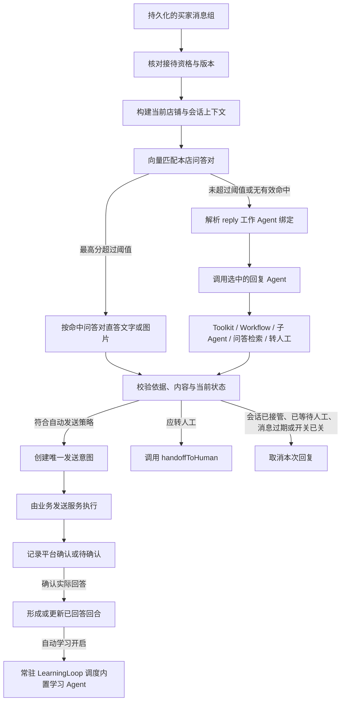
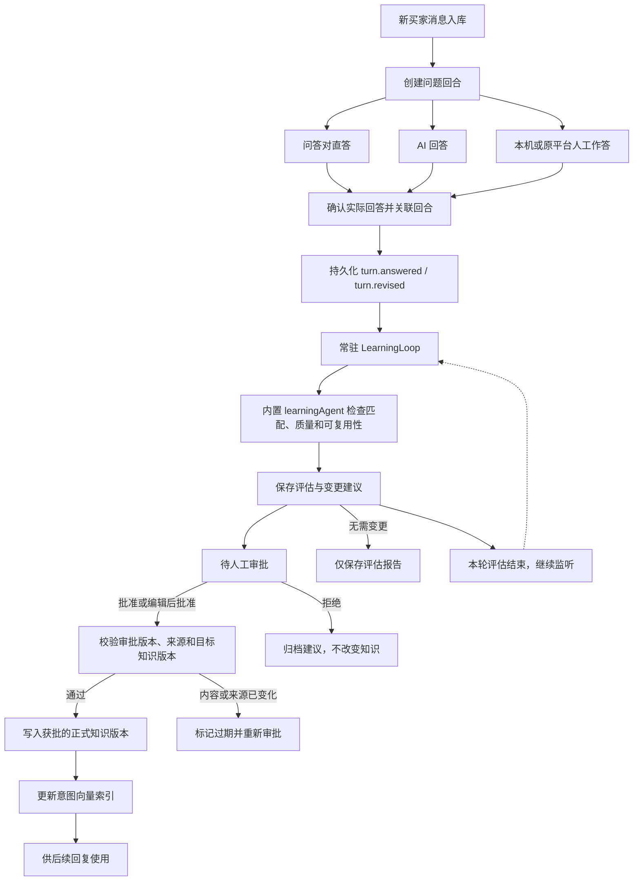

# AI 自动回复与问答学习

版本：v0.7  
方案日期：2026-09-07  
状态：已提供拼多多首版实现；实际交付、验证证据与待实测项见[实现与验证记录](implementation-status.md)。

## 1. Mastra 的职责

Mastra 运行在本地业务进程，负责向量检索、未命中时的回复编排（`replyAgent` 及其子 Agent），以及每轮问答后的 **内置** 学习 Agent（`learningAgent`）。用户在 Agent Studio 搭建的只是自动回复编排；学习 Agent 随产品发布，不能被绑定、复制或替换。回复实例由 AgentRuntimeFactory 按有效配置快照构建。使用本地 LibSQLStore 保存必要运行状态，LibSQLVector 提供意图向量检索。

业务服务决定是否接待、是否允许发送、使用哪个账号、知识是否有效和任务如何恢复。自动发送统一经过[发送意图与状态机](data-design.md)，无论直答还是 Agent，都不能直接操作网页或绕过发送记录。

首版使用宿主管理的 `replyWorkflow` 和内置 `learningWorkflow`。`replyWorkflow` 先做高阈值问答对匹配，未超过阈值再进入当前绑定的回复 Agent；该 Agent 可再调用已挂载的 Toolkit、Workflow 与子 Agent。后台常驻的 `LearningLoop` 监听已回答的问答回合，为每个可评估版本调度一次内置 `learningWorkflow` / `learningAgent`。索引构建、清理和历史补拉是可恢复的业务任务。高级用户只扩展回复侧步骤；总流程的接待、高阈值直答、已回答事件、发送与知识审批规则保持固定。

自动学习有独立的店铺开关 `LearningPolicy.autoLearnEnabled`。开启后，学习 AI 临场回复和本机或原平台人工作答；已经按问答库原文发出的直答不再评估。关闭自动回复、点进会话或处于转人工等待，不会关闭学习。学习发生在实际回答之后，不增加当前回复的发送前等待。

学习结果必须人工审批后才能生效。内置学习 Agent 自动保存评估并生成问答新增、修改等建议；只有人工批准的具体候选版本才能写入正式知识、更新索引并用于后续回复。开启学习不代表授权自动发布知识，也不代表可以换成自己搭建的学习 Agent。

Mastra 的 Workflow 提供结构化步骤和内置执行能力，参见[工作流文档](https://mastra.ai/docs/workflows/overview)。本方案中的业务步骤、审核规则和发送控制需要自行实现。

### 1.1 Agent 配置与业务入口

Agent Studio 默认隐藏，仅开发者模式可见。它只编辑自动回复编排：提示词、模型、Memory、Toolkit / Workflow / 子 Agent 和运行限制。草稿用于编辑与调试，发布生成不可变修订，工作设置再选定 reply 的全局默认或店铺覆盖。平台预置可删除的“默认自动回复”Agent；删除后可一键加回，不会在启动时自动重建。学习 Agent 不是可编辑模板，界面不提供“设为学习 Agent”。同一回复配置被多个店铺使用时，运行上下文与记忆仍彼此隔离。

运行开始时解析回复绑定、子 Agent 闭包、模型、资源代码和有效设置，保存 RunConfigSnapshot。发布新版本会把已绑定该 Agent 的工作入口切到最新修订，并更新受影响店铺的 replyConfigEpoch。尚未发出的旧回复必须失去发送资格。学习评估使用内置 Agent 版本与 LearningPolicy；策略变更使未完成评估重排，已经产生的实际回答、评估或候选保留当时版本，切换回复编排不扫描学习历史或改变知识批准状态。

Toolkit / Workflow / 子 Agent 的挂载、成员 schema 与调试见[Agent 配置与高级扩展](agent-customization.md)。宿主直接调用本轮已绑定的回复 Agent，由 Agent 按需调用已挂载能力。Workflow 不能覆盖 agentId、模型身份，也不能调度学习 Agent。运行失败不会静默改用另一个 Agent：回复路径按故障规则转人工，学习保留可恢复积压；高阈值直答仍按自身依赖判断。

## 2. 接待开关、显式接管与转人工

店铺接待只有开、关两种状态，没有辅助草稿模式。会话级还有两种会暂停 AI 接管的情况。

| 条件                                 | 行为                                                                                 |
| ------------------------------------ | ------------------------------------------------------------------------------------ |
| 关闭自动回复                         | 聚合消息，由人工处理；不自动生成、不自动发送                                         |
| 开启自动回复，会话未接管且未等待人工 | 满足策略与通道验收条件时由 AI 接管并自动发送                                         |
| 人工点进该会话                       | 只更新查看和未读，不暂停 AI                                                            |
| 人工回复或普通订单操作               | 不切换接待模式，不取消当前或后续 AI 回复；平台同步到的人工回答遵循相同规则               |
| 显式接管或转接客服                   | 暂停当前会话 AI，处理完成后明确点击「交还 AI」                                          |
| AI 转人工                            | 该会话进入等待人工；AI 不再自动回复。由人工处理后明确点击「交还 AI」，才接待之后的新消息 |

开启自动回复时，默认由 AI 接待所有未被人工接管、未等待人工的会话。查看不暂停；显式接管只影响这一个会话。账号暂停和通道失效会取消执行资格；回复和学习均不设每日调用次数上限。

店铺开关、人工接管和转人工等待都存入业务库；界面选中态只表示正在查看。所有自动任务都在开始和发送前读取这三项。切换会话、隐藏到托盘或重启，都不会自动交回 AI。

### 2.1 转人工工具

`handoffToHuman` 是首版必须提供的控制工具，不是可选项。它只出现在 Agent 路径：高阈值已直答时不会在当前回复链路转人工，也不会仅为复核这条直答再走学习。Agent 在知识不足、平台工具仍无法确认、需要人工决策或不宜自动承诺时调用它。工具由业务服务执行，模型不能自己改会话状态或操作网页。

工具成功执行时先保存本轮转人工意图和真实原因，并立即结束本轮生成，不再请求模型生成转接提示。与 `submitReply(action=handoff)` 共用以下业务处理：

1. 业务服务在串行控制入口内重新校验原始消息组、会话 revision、接待资格和配置代次。生成期间有新输入、人工接管或策略改变，旧意图仍取消，不能跳过 `STALE` 检查。
2. 同一事务内将会话标为 `awaitingHuman`，开启新的人工等待周期、递增 revision；将当前 AiRun 和 Job 记为成功，保留转人工原因；取消其他待执行回复与尚未提交的自动发送。当前任务不会取消自己。
3. 同一事务创建一条 `origin=handoff_notice` 的 OutboundMessage，意图键按会话与触发消息组去重。提示固定为“已为您转人工，请稍候。”，由宿主直接生成，不使用模型额外生成或修复，也不采用模型声称某位客服已接入的文本。
4. 提示按转人工后的会话 revision 发送，仅允许该会话仍等待人工、未被人工接管、账号就绪、路由和配置未变化时提交。仍走平台精确回执链路；提示取消、被拒绝或结果待确认，不改坏已经完成的转人工结果，等待人工继续保留。未知结果不重发，重启不补发旧提示。
5. 在工作台展示待人工状态和原因。重复转人工只更新原因，不开启并行等待周期；本轮不会产生重复提示。其他会话的 AI 接管不受影响。

目前 PDD 的转人工表示交给本机 JuDesk 人工接待，尚未实现平台侧指定客服分配，因此不显示或承诺“客服 XX 已接入”。自动回复故障、无工作 Agent 等保护性暂停仍只提示工作台，不向买家发送未经正常转人工结果触发的提示。

转接提示仅作为会话消息归档，不关联为业务回答、不创建 AnsweredTurn / 学习事件，也不能设置 `humanSentAfterHandoff`。手动关联入口同样不接受该来源。经 Workflow 包装的执行错误也必须由业务层复核当前资格，防止把真实人工接管误当成模型故障再次转人工。

处理完成后必须明确点击「交还 AI」，之后只处理新的买家消息。仍有待发送消息、未知回执或待核对业务操作时不能交还；人工回复、离开会话、隐藏到托盘或应用重启都不会自动交还。

## 3. 自动回复工作流

回复分两段，先匹配再生成：先用向量检索本店问答对；只有最高分有效结果超过高阈值时，直接发送该问答对的答案或图片。没有超过阈值时，才调用当前绑定的回复 Agent。该 Agent 可以使用已挂载且通过当前账号校验的平台工具、子 Agent、再次检索问答对，以及转人工。用户编排不进入学习路径。



### 3.1 触发与消息合并

仅对已经去重入库、店铺已开启自动回复、当前未被人工接管、且未等待人工的买家输入触发。平台机器人、系统通知、自己的回显消息不能形成回复循环。人工接管会话期间，或转人工后尚未交回 AI 的新消息，都不进入自动回复工作流。

短时间内的连续买家输入形成 MessageGroup。合并窗口通过配置和实测调整；持续输入时设定最长等待时间，避免任务永远无法开始。窗口结束后保存消息集合与会话 revision。

模型生成期间又有新消息时，旧结果失去发送资格。调度器根据最新消息组重新评估，不对每条输入立即启动互相竞争的生成请求。

### 3.2 构建可信上下文

上下文由业务服务绑定 storeId、accountId、conversationId、消息组、接待策略版本、路由版本及 replyConfigEpoch，不能由模型改写。进入 Agent 路径时还绑定 AgentRevision、策略 Workflow、集合产物与设置版本；模型输出、工具调用和发送意图都关联同一运行快照。

首版从业务库组装当前会话的近期消息；超出上下文预算时使用带来源和更新时间的摘要。摘要是派生数据。高阈值直答只使用命中问答对的原文或图片；Agent 路径中价格、库存、售后政策等需要核验的信息从问答检索或平台工具获得。

Mastra Memory 如启用，仅限当前店铺的当前会话，resource/thread 标识由宿主生成，包含资料库、店铺、会话、角色及生产 / 调试隔离维度。Agent 配置不能放宽这个范围；不同 Agent 默认使用各自的派生记忆空间，切换后仍可从业务消息重建上下文。默认关闭跨会话的语义记忆召回，不能因为同属一家店或复用同一 Agent 就向其他买家提供个人信息。

### 3.3 高阈值问答对直答

问答对按意图建向量，答案原样发送，不经过模型改写。首版支持两类：

| 类型      | 向量匹配对象 | 命中后发送           |
| --------- | ------------ | -------------------- |
| 意图-回答 | 意图文本     | 该修订的文字答案     |
| 意图-图片 | 意图文本     | 该修订绑定的图片附件 |

匹配步骤：

1. 只用当前店铺、已启用、未过期、适用范围符合当前会话的生效修订。
2. 对买家消息组做 Embedding，同时检索本店与通用意图向量。
3. 每个向量命中必须回查业务库；停用、过期、错店或附件缺失的结果直接丢弃，分数再高也不能直答。
4. 从数据库补齐同意图与明确覆盖规则；无条件本店覆盖通用。有商品/条件规则或最高候选分差 0.04 内存在不同答案时交给现有回复 Agent。只有无歧义且最高分 **超过** `directMatchThreshold` 才直答。详见[问答优先级](reception-and-knowledge-rules.md)。
5. 超过阈值且通过上述冲突与适用性检查时，只采用选中的问答对，不混合多条答案，也不调用 `replyAgent`。这条原文直答不再送去学习；之后若有人工纠正或 AI 另作回答，再按学习开关评估。

`directMatchThreshold` 默认 `0.6`，分数必须严格超过该值才直答。过低容易把相近问法误判成命中；更换向量模型后要重新评估，不能沿用旧阈值。索引未就绪或 Embedding 不可用时，不能直答，转入 Agent 或在无模型可用时转人工。

直答路径记录 `AiRun.path = direct_match`，证据指向命中的 revisionId、分数、阈值、Embedding 配置和发送时答案快照。发送的是问答对原文或原图，业务层不得让模型改写后再发出。直答本身不调用学习模型。

### 3.4 Agent 路径

没有任何有效命中超过阈值时，进入当前工作绑定选择的回复 Agent / 策略 Workflow。可用能力是挂载集合、已挂载子 Agent、当前账号已验收能力和本轮业务范围的交集；内置默认模板可以挂载全部已验收平台集合，高级用户可以缩小范围或拆到子 Agent。未验收或 `Capabilities` 为 false 的能力不得出现在工具列表里。`searchQaPairs`、`handoffToHuman` 与 `submitReply` 由宿主强制提供，不能通过取消挂载移除。子 Agent 在每轮开始时解析当前发布配置，并按本轮快照调用，权限只能缩小不能扩大，发送仍回到本轮 OutboundMessage。

问答工具按需使用，不是每轮必经步骤。Agent 先使用实际对话、宿主预检索传入的 `knowledge` 和已有工具结果；只有仍缺少具体的商品说明、使用方法或店铺政策时才补查。实时价格、库存、订单状态和物流进度直接使用对应平台工具，问候、澄清和明确转人工无需先查问答。运行时统一注入这些规则，已有发布配置与自定义 Agent 同样适用。

`knowledgeSearch` 标明宿主预检索的 `query` 和 `completed` / `failed` 状态；无预检索的调试调用标为 `not_run`。完成但未命中与检索失败分开处理，失败仍允许按需查询。预检索及 Agent 补查的结果在同一次回复内按问题复用（只归一化空白），包括空结果；Toolkit、Workflow 与子 Agent 共用该缓存，下一次回复重新查询。相似度未过直答阈值不构成重复搜索的理由；补查应针对新线索或具体缺少的知识点。

建议登记的工具包括：

| 类别     | 工具                               | 作用                                                                                  |
| -------- | ---------------------------------- | ------------------------------------------------------------------------------------- |
| 知识     | `searchQaPairs`                    | 现有上下文缺少具体业务知识时按需补查；复用已查结果，不要求超过直答阈值                |
| 控制     | `handoffToHuman`                   | 交出该会话控制权，规则见 2.1                                                          |
| 结果     | `submitReply`                      | 用本轮工具调用参数提交最终 ReplyCandidate；收到后立即结束，不直接发送                 |
| 平台     | 已挂载 Toolkit 中允许的读写能力    | 如会话历史、商品、SKU、足迹、订单、物流、发图、转接等，以该账号能力矩阵和本轮权限为准 |
| 流程     | 已挂载 Workflow 集合中的可调用成员 | 用明确输入 / 输出 schema 组织查询和处理步骤；依赖沿用当前权限与预算                   |
| 子 Agent | `runSub(alias)`                    | 调用本轮快照中已解析的其他回复 Agent；不能指向学习 Agent 或任意 ID                        |

平台工具的上下文固定到当前店铺和当前买家允许访问的对象。不支持的调用返回 unsupported，不能用其他店铺数据补齐。发送文字或图片仍创建 `OutboundMessage`，不能由工具直接打网页或绕过状态机。Workflow 的发送请求也走同一入口；工具调用产生的消息与最终 ReplyCandidate 统一按问题和用途协调，不能让一次工具发送后又自动重复发送相同回答。

普通文字接待直接使用 Agent 正常完成的最后一步正文，本地构造 `action=reply`、正文、上下文依赖和 `reasonCode=agent_text`，不要求模型输出 JSON，也不追加模型整理请求。只取最后一步的文字内容，不能把推理内容、之前步骤的工具说明、截断输出或失败结果拼入回复。正文路径的依赖集合来自本轮真实提供的知识和工具依据，表示发送前需要再次核对的上下文依赖，不伪装成模型逐条引用。

图片或显式动作通过当前生成中的 `submitReply` 工具参数提交，工具本身不发送消息；收到该工具调用后立即停止。参数无效或工具失败时不回退发送同时产生的正文，也不追加格式修复请求。知识查询等仍可使用正常 Agent 循环，但提交最终回复、转人工或达到步骤上限后不再请求模型。普通问候可直接一次请求生成正文。

Agent 输出建议使用以下逻辑结构：

```ts
type ReplyCandidate = {
  action: 'reply' | 'clarify' | 'handoff' | 'ignore';
  text?: string;
  attachmentId?: string;
  evidence: Array<{
    kind: 'knowledge' | 'message' | 'tool_result';
    id: string;
    version?: number;
  }>;
  reasonCode: string;
};
```

输出用 Zod 校验。`reply` 和 `clarify` 必须包含可发送文本或已校验附件；`handoff` 必须包含 `reasonCode`，并走与 `handoffToHuman` 相同的业务入口。证据 ID 必须真实存在于本次工具结果或检索集合中。模型捏造的 ID、引用其他店铺的资料或格式无效的结果不能进入发送步骤。

知识不足、工具仍无法确认或不宜自动承诺时，应转人工，而不是编造答案。模型自报“置信度高”不能代替直答阈值，也不能单独决定发送。该路径记录 `AiRun.path = agent`。

### 3.5 发送前校验

直答或 Agent 完成后，都要重新读取会话 revision、店铺自动回复开关、该会话是否仍被人工打开或等待人工、账号路由、策略、知识状态和 replyConfigEpoch。Agent 路径还必须确认所用工作绑定、资源与设置仍有执行资格；旧配置输出不得因为格式正确就被发送。即使匹配或生成时允许自动回复，发送时也必须仍然符合条件。人工在处理期间点进该会话，本次自动发送只能取消。Agent 决定转人工时取消普通回复候选，只按 2.1 的专用规则创建一次转接提示。

直答还要再次确认命中问答对仍启用、附件仍在、分数记录仍高于当时阈值。Agent 发送还要校验回复长度、附件能力、敏感信息范围和店铺禁止承诺的内容。

普通自动回复仅在店铺仍开启自动回复、会话未被接管、未等待人工且校验通过时创建 OutboundMessage。转接提示使用已提交的转人工状态与新 revision，其他发送前条件相同，不能借此放行普通 AI 回答。关闭自动回复或正在等待人工时既不直答也不调用 `replyAgent`；人工实际回答后的学习由独立开关控制。未知发送结果的处理遵循数据文档，不能由模型判断“应该没发出去”然后重试。

### 3.6 问答库导入、编辑与图片

问答库是日常接待功能，**不需要开发者模式**。侧栏或设置中的「问答库」对所有用户可见，按当前店铺隔离。用户可以新建、编辑、启停、删除和导入问答对；Agent Studio 打不开也不影响这些操作。

每条问答对仍是「一个意图 + 一种答案」：

| 类型      | 用户维护内容                                     | 直答时发送   |
| --------- | ------------------------------------------------ | ------------ |
| 意图-回答 | 意图文本、文字答案，可选适用商品 / 条件 / 有效期 | 文字答案原文 |
| 意图-图片 | 意图文本、一张已入库图片，可选适用范围           | 该图片附件   |

界面支持：

- 手工新建：填写意图，选择文字或图片答案；图片从本地选择后写入受控附件目录，记录类型、大小和哈希。
- 编辑：改意图、改文字、替换图片或调整范围。编辑生成新的 KnowledgeRevision，不原地覆盖旧答案；旧版本保留供审计，生产检索只读 `activeRevisionId`。
- 删除：启用或停用问答均可直接确认删除，没有归档步骤。删除时校验当前修订，删除后不可编辑或恢复，从管理列表、话术、检索和知识包导出中排除，关联的待审批/待应用修订建议失效。删除启用问答会更新相关店铺的接待配置代次，阻止基于旧规则生成的未发送回答继续发送。历史回答、不可变引用版本和共用图片保留，新的同意图问答仍可独立创建或导入。
- 导入：选择本店目标后导入文件。首版至少支持 JSON，以及「清单 + 图片目录」的压缩包。每行包含 intent、answerKind、answer 或 image 文件名、可选 scope。导入先预览冲突、缺图、超限和跨店字段，用户确认后写入；默认不覆盖已有正式知识，冲突行需选择跳过、新增问法或生成新修订。
- 导出：可导出当前店铺问答（含图片文件），不含 Cookie 和模型密钥。

人工新建、编辑、导入属于人工作业，`sourceKind` 为 `manual` 或 `import`，`approvalSource = human`。校验店铺、意图非空、答案类型完整、图片可读且不超过已验证的附件上限后，直接发布为正式知识并安排索引，**不进入学习审批队列**。学习 Agent 随后仍可评估这些知识的使用效果，但不能改写用户刚保存的内容，除非再生成待审批修订。

图片约束：只接受已声明的安全类型（如 jpeg / png / webp / gif），校验大小与像素上限；不把远程未下载 URL 当作已入库附件。缺图、损坏或类型不符的导入行失败，不影响同批已确认的其他行。意图-图片的向量仍然打在意图文本上，不把像素当作匹配键。

关闭开发者模式、删除默认回复 Agent 或关闭自动学习，都不关闭问答库。没有回复 Agent 时，已导入的问答对仍可做高阈值直答。

## 4. 常驻问答学习 Agent Loop

自动学习的目标是持续发现可沉淀或需修正的「意图-回答 / 意图-图片」，生效前统一由人工审批。开启后，后台常驻学习循环；平台有新的买家问题且产生了 AI 临场回复或人工作答，就形成学习触发条件。已经按问答库原文直答的回合不评估，避免把现成问答再学一遍。用户编排的回复 Agent 和子 Agent 不参与评估。

### 4.1 循环、内置 Agent 与开关

`LearningLoop` 是业务进程内常驻的事件消费者，`learningAgent` 是随应用发布的内置 Mastra Agent，不是 AgentBinding 的目标。循环的空闲阶段等待事件；有待评估问答时执行一轮有限步数的内置推理与工具查询，保存结果后继续等待下一轮。服务运行期间持续监听，状态和进度存入业务库。用户不能在配置台更换其提示词、工具集或内置学习流程。LearningPolicy 只负责开关、采集与预算，以及可选的内置模型引用；没有“店铺专用学习 Agent”。

| 自动回复 | 自动学习 | 行为                                       |
| -------- | -------- | ------------------------------------------ |
| 关闭     | 关闭     | 人工接待，不执行在线学习                   |
| 开启     | 关闭     | 继续直答 / AI 回复，不执行在线学习         |
| 关闭     | 开启     | 人工实际回答后照常评估，生成待审批问答建议 |
| 开启     | 开启     | AI 临场回复和人工作答进入学习；问答直答不评估 |

首版提供自动学习开 / 关。开启后执行“自动评估 → 生成待审批建议 → 人工批准 / 编辑后批准 / 拒绝 → 批准版本生效”的流程。所有由学习产生的新增问答、答案修订、图片替换、问法补充、适用范围变更和停用建议，都必须人工批准；高置信度、来源充分或内容来自人工回答也不能跳过审批。

评估报告与使用记录可以自动保存供人查看，但不能据此直接调整匹配阈值、排序、知识启停或回复内容。没有知识变更的回合只保留评估，不强制创建一条无变化的审批单。

内置学习 Agent 使用固定的提示词契约、受限工具集和独立调用记录。可选模型引用写在 LearningPolicy，不能用回复 AgentRevision 覆盖。每轮绑定当前店铺、会话与问答版本；常驻服务不共享所有买家的模型聊天历史，跨轮可复用的成果通过知识库与评估记录保存。

### 4.2 触发单位：买家问题获得实际回答

业务模块建立 `AnsweredTurn`，关联本轮买家 `MessageGroup` 和实际回答的消息集合。消息组在人工和自动接待下都会形成，不依赖 `replyWorkflow` 是否启动。

满足以下条件后，提交 `turn.answered` 业务事件：

1. 买家问题已去重入库，能确定所属店铺、会话和问题范围。
2. 有一条或多条实际回答，可以关联到这个问题回合。
3. 本机发送具有 confirmed 状态，或已从原平台收到可验证的人工作答事件。

这些事实事件与学习开关无关，均由业务层持久化；消费者只将学习开启期间采集、或对应未完成恢复范围的事件加入学习队列。事件携带采集时的启用代次，避免关闭期间的旧回答在再次开启后被默认当作新学习输入。

模型生成草稿、命中问答对、点击发送、等待回执或单纯转人工，都还不代表产生了实际回答。`unknown` 发送确认成功后才推进回合；单独的新问题先等待回答，不做最终答案评估。

无需等待会话结束或一段长时间无人说话。每次实际回答入库即标记待评估，可用有最大等待时限的短合并窗口收集同一次回复的多条文字和图片；持续回复时仍要按版本产生评估。

后来追加回答、人工纠正 AI、修改或撤回来源时，递增同一回合的 `sourceRevision`，生成 `turn.revised` 或 `turn.invalidated`。新问题形成新的回合；如果后续反馈是在纠正旧答案，也要关联旧回合。回答配对以本机发送的触发 ID、平台引用关系和会话顺序为依据，不能把时间最近的一句任意当作答案。无法可靠配对的回合保留待关联状态。



待审批建议进入独立审批队列，本轮学习任务即可完成，LearningLoop 继续处理其他问答，不长期占用模型调用或任务租约等待人工。审批、索引更新和学习结果本身不产生新的买家问答事件。没有新的实际问答或来源修正时，不自我触发下一轮模型调用。

### 4.3 每轮 Agent 的输入

一次 `learningWorkflow` 接收明确版本的问答快照：

- storeId、conversationId、turnId、sourceRevision、学习策略版本、采集记录，以及当前学习 RunConfigSnapshot / learningConfigEpoch。
- 买家问题原文、必要上下文、实际回复的文字或图片、消息 ID 与时间顺序。
- 每条回答的来源 `qa_direct`、`ai` 或 `human`，以及本机 / 原平台渠道。一次回合可以包含 AI 后接人工纠正等多种来源。
- 直答使用的问答 revisionId、意图、原答案、实际分数、当时阈值与适用范围。
- AI 当时使用的知识、平台工具结果、回复 AgentRevision、子 Agent、策略 / 集合版本、模型和提示词版本，以及实际发出的最终内容；这些回复证据与本轮内置学习评估器版本分开保存。
- 后续人工纠正、可核验的用户反馈，以及已有评估和相关知识修订。

发送时快照用于判断当时是否合理，当前知识用于决定现在是否需要更新。原知识已经变化时，不能只用现在的答案替代当时的证据。

文字与图片回答都进入循环。评估图片需要可读取的受控附件和支持相应理解能力的模型；附件缺失或无法理解时明确标为不确定，不虚构图中内容，也不自动生成错误的意图-图片知识。

### 4.4 三类回答的评估职责

| 回答来源       | 必须检查                                                                                | 可以产生的沉淀动作                                                   |
| -------------- | --------------------------------------------------------------------------------------- | -------------------------------------------------------------------- |
| 已有问答对直答 | 买家意图是否匹配；商品和条件是否适用；答案或图片是否真正回答问题；高分是否误命中        | 记录匹配报告；提出问法、适用范围或答案修改建议，审批后生效           |
| AI 回答        | 是否理解问题；回答与工具 / 知识依据是否一致；是否遗漏条件或编造承诺；后续是否被人工纠正 | 记录质量问题；提取可复用的候选问答或修订建议，统一待人工审批         |
| 人工回答       | 是否对应当前问题；是否可泛化；是否为一次性处理；是否补全或纠正已有答案                  | 自动提取新问答、问法补充或旧答案修订建议；人工来源仍须审批后入库生效 |

“匹配错了”和“答案本身错了”分别记录。一个商品的正确答案被用于另一个商品，不足以全局停用原知识或自动修改所有店铺的 `directMatchThreshold`；应记录具体误匹配并检查意图和适用范围。

所有三类回答都被评估，但被评估不等于成为正确事实。问答对原样回显、同一个 AI 的自我肯定、同一来源衍生的多条记录，不能被计为多份独立佐证。人工回答也要检查适用条件和一次性承诺。

### 4.5 评估结果与待审批建议

内置学习 Agent 输出结构化结论，由 Zod 验证。以下为业务输出契约草案：

```ts
type LearningAction =
  | { type: 'keep'; reasonCode: string }
  | { type: 'record_issue'; category: string; evidenceIds: string[] }
  | {
      type: 'create_qa' | 'revise_qa' | 'add_intent_variant' | 'disable_qa';
      candidateId: string;
      targetEntryId?: string;
      expectedActiveRevisionId?: string;
      evidenceIds: string[];
    };

type LearningReview = {
  turnId: string;
  sourceRevision: number;
  matchVerdict: 'correct' | 'incorrect' | 'uncertain' | 'not_applicable';
  replyVerdict: 'reasonable' | 'unreasonable' | 'uncertain';
  reuseVerdict: 'reusable' | 'conditional' | 'not_reusable' | 'uncertain';
  reasonCodes: string[];
  evidenceIds: string[];
  actions: LearningAction[];
};
```

`candidateId` 指向本轮持久化的待审批建议，带有 candidateVersion 和 contentHash，包含意图、答案类型、文本或图片、店铺 / 商品范围、条件、有效期、来源及目标变更。多种回答混合的回合同时保存按回答消息划分的评估明细，避免只给整轮一个分数而丢失人工纠正关系。

内置 `learningAgent` 可以查询本店已生效知识、来源消息和必要的已验收只读平台信息，并写入评估与候选建议。业务校验通过后只将建议放入审批队列，不直接修改正式知识。它不拥有审批、发布、买家消息发送、订单修改、转人工或调用用户回复编排 / 子 Agent 的权限。用户 Toolkit、嵌套 Workflow 不能挂到学习入口。工作流或模型输出不能伪造人工作业的 approvalId，评估失败也不回头阻塞已经完成的回答。

所有待审批建议与正式知识分开保存。审批前不改变 activeRevisionId，不进入生产向量索引，不参与高阈值直答，也不能被 `replyAgent` 的知识工具或 Memory 当作已生效知识读取。待审批内容可以在学习侧用于去重和冲突比较，但必须保留未批准标签。

已有知识足以表达本轮内容时保留并关联这次使用记录，不重复插入同一问答。评估发现异常可以在工作台提示，学习循环不自行向买家追发“纠正消息”。

### 4.5.1 单次学习生成与结果校验

内置学习评估器使用 `learning-json-v2` 协议：一次 Mastra 生成中，向模型提供明确 JSON Schema，读取正常完成的最后一步正文，并在本机完成 JSON 解析和 Zod 校验。GLM 使用 `response_format=json_object`。只兼容完整 JSON 对象或整个正文被单个 JSON 代码块包裹的形式；不从推理文本、说明文字中猜测字段，不修复截断 JSON，不把空结果填成“无需学习 / uncertain”。不依赖可能缺失的 `response.object`，也不额外调用格式整理模型。

`glm-5.3` 和 `glm-5.3-flash` 的学习调用设置官方支持的低思考强度 `reasoning_effort=low`（Mastra providerOptions 使用 `reasoningEffort`）。这两个模型不能关闭 thinking；不发送 `thinking.type=disabled`，不静默提高用户设置的 `maxTokens`。其他模型不注入该专有参数，回复 Agent 的思考行为保持其原配置。

得到供应商用量后，先写入 AiRun，再校验结构和业务来源。失败记录也应保留 inputTokens、outputTokens、reasoningTokens、finishReason、正文长度、工具数、maxOutputTokens 和本轮输出模式 `learning_json`；不保存内部推理正文。`finishReason=length` 即使伴随可解析的片段，也不能作为完整评估入库。

空正文、输出截断、非 JSON、缺少字段以及不存在的证据，均作为不可自动重试的输出错误：本次 Job 失败，不生成 LearningEvaluation / 候选，不再自动发起相同请求。运行记录展示明确原因；修正模型配置后，用户可以显式重试该学习任务。暂时性请求故障仍遵循有界重试；停止自动学习、来源撤回和配置变更仍按原有失效与重排规则处理。

资料核对：Z.AI GLM-5.3-Flash 与迁移指南（`https://docs.z.ai/guides/vlm/glm-5.3-flash`、`https://docs.z.ai/guides/overview/migrate-to-glm-new`）。这些参数策略随评估器版本一起锁定，避免把新策略误认为旧评估器的结果。

### 4.5.2 学习证据清单与引用编号

学习评估器版本 `learning-evidence-v4` 为每轮生成统一的 `evidenceCatalog`，将实际问题、回答、上下文消息和知识修订映射为 `E1`、`E2` 等短编号。消息 / 知识正文携带对应的 `evidenceRef`；模型的 `evidenceIds` 逐字引用清单中的 `ref`，本地程序在一次生成后映射回真实消息 / 修订 ID，供评估、候选审批和追溯使用。为兼容直接返回真实 ID 的模型，清单中真实存在的原始 ID 也可接受；清单以外的编号不会猜测、删除或补齐。

不再把 TurnAnswer 关联记录 ID、发送意图 ID、AI 运行 ID 和完整历史回复输出混进学习材料。知识条目使用 `entryId`，只作为 `targetEntryId` 的修改目标，证据必须引用其具体修订。历史回复引用的消息只从同一店铺 / 会话、未撤回、回答之前的实际记录回填；引用的知识修订按店铺查实并补齐正文，包括不在首批知识列表中的历史版本。旧版 / 停用知识明确标记 `isActive=false`，不能当成当前可承诺的答案。

平台工具临时编号、跨店铺资料或其他找不到实际来源的历史引用不进入模型证据清单，模型只看到 `unavailableEvidenceCount`，应承认无法核验；原编号保留在运行记录的 `evidence.omittedReplyRefs`。这类引用存在于 AI 回复输出中，并不证明其对应的原始工具结果已经被持久化，也不能当作 AI 自评的独立事实依据。

已经解析成功的模型结果在业务校验前保存。即使引用校验失败，`output` 仍保留模型实际返回的评估结果，`evidence.catalog`、`returnedEvidenceIds`、`invalidEvidenceIds` 可直接定位问题。错误记录中列出无效编号，失败任务不自动重试、不创建评估或候选，也不放宽审批条件。成功结果保存映射后的真实 ID；整个引用处理不增加模型请求。旧版本失败记录因未保存原输出，无法补还原无效 ID，需要用户更新后显式重试学习任务。

### 4.6 人工审批、版本与反馈闭环

审批页面展示原始问答、回答来源、匹配 / 质量判断、拟新增或修改内容、与当前知识的差异、适用商品、有效期和冲突说明。抽取时已移除的不必要个人信息不重新暴露；图片建议提供可预览的附件。

人工可以执行三种操作：

| 操作       | 结果                                                 |
| ---------- | ---------------------------------------------------- |
| 批准       | 批准当前看到的候选版本，经校验后发布                 |
| 编辑后批准 | 保存人工编辑后的新候选版本，再明确批准该版本         |
| 拒绝       | 记录原因并归档，不创建或替换正式知识，不更新生产索引 |

候选状态由 KnowledgeCandidate 管理，使用 pending_review、approved、rejected、stale。KnowledgeReview 保存 reviewerId、reviewedAt、decision、candidateVersion、contentHash、sourceRevision 和 expectedActiveRevisionId。审批身份由工作台的人工作业上下文确定，不接受模型提供的 reviewerId。

任何候选内容、适用范围、图片、来源版本或目标知识版本变化，都使旧审批失去提交资格。编辑候选时生成新版本；已批准后又发生变化的内容重新进入待审批，不能把旧批准继承到新答案上。批量审批也要明确列出并绑定每一条候选的版本，不能批准之后才产生的建议。

只有人工批准且通过版本与来源校验的候选，才创建正式 KnowledgeRevision 或应用获批的知识停用操作。学习产生的正式修订记录 `approvalSource = human`、approvalId 和 evaluationId；Agent 只作为建议来源 `proposedBy = learning_agent`。KnowledgeEntry 保留 enabled、disabled、deleted 状态与 activeRevisionId；deleted 为终态，旧学习建议和迟到的学习结果均不能恢复已删除目标。

审批记录与知识发布任务持久化。任务执行时再次核对批准内容、来源和目标版本，成功提交后更新正式知识并安排索引任务；失败或冲突进入明确状态。待审批或被拒绝的候选不会因为重启、重试、超时或队列恢复而自动通过。

原知识在修改建议待审批期间继续按原有规则使用。学习 Agent 判断答案不合理，只产生报告或停用 / 修订建议，不能自行停用或修改知识。买家新反馈和人工纠正更新回合版本，生成新的评估和待审批建议，不自动覆盖已批准的答案。

实际来源被删除或撤回、附件丢失、有效期届满等可确定的数据失效，仍由业务规则过滤并提示复核；这是原有有效性约束，不把 Agent 的主观判断当作已经成立的数据失效。涉及补充、替换或重新启用知识的学习建议同样需要人工审批。

### 4.7 常驻生命周期、积压与防重复

- 开启学习时持久化策略与在线事件边界，启动该店铺订阅。默认不扫描全部历史聊天；手动历史导入使用独立任务。
- 循环领取持久化的 `evaluate_answered_turn` 任务。同一回合按 sourceRevision 串行，跨会话有限并发；无新任务时等待，不反复调用模型。
- 去重键为 `storeId + turnId + sourceRevision + evaluatorVersion`。evaluatorVersion 是内置学习 Agent 版本、所选模型引用、评估规则和 LearningPolicy 非密钥设置的指纹，不是一次调用的随机 ID，也不包含用户回复 Agent。重发事件或进程重启不重复创建相同审批建议；人工批准后的发布使用绑定 approvalId 与候选版本的稳定 applyKey，防止重复生效。
- 内置学习版本或 LearningPolicy 变更后，尚未提交的旧评估记为 superseded，核对来源和开关后重排；已经完成的评估与候选不因此重新生成或自动失效。切换回复 Agent 不影响学习去重键。
- 来源版本更新后，旧评估及相关候选标记过期，未应用的批准重新复核，不能沿用旧结论发布。合并窗口内旧版本标记为被新版本包含；没有被替代的已回答回合必须有评估、待处理或明确失败记录。
- 关闭学习后停止领取新的学习任务，递增启用代次；旧代次在途结果可保存诊断，但不再提交新建议。已有待审批建议仍可人工审批，已经明确批准的发布和索引任务继续按审批记录执行。再次开启后复核学习积压再恢复，不把开关代替人工审批。来源删除与知识失效过滤照常生效。
- 关闭自动回复、人工打开会话或转人工等待仅影响接待；学习循环仍可评估人工回答。退出应用或系统休眠时停止执行，恢复后按持久化记录续做。
- 单次生成输出、Agent 工具步骤和重试都设上限。回复和学习的每日调用次数无限制；模型供应商限流、超时或请求故障仍按原有重试与失败记录处理，不能把学习故障变成买家重复回复。

## 5. 向量与索引管理

使用 `@mastra/libsql` 的 LibSQLVector，向量保存在本地 `mastra.db`。这是与模型 API 调用分开的步骤：向量存储和相似度查询在本机，文本向量生成可以调用用户配置的 Embedding API。

EmbeddingProfile 固定供应商、模型、维度、归一化方式和文本处理版本。向量按 **意图文本** 构建，不把答案正文或图片像素当作匹配键。使用独立的索引名称和确定性 vectorId，元数据包含 storeId、entryId、revisionId、answerKind、商品范围及配置 ID。

生产索引只接收已人工批准并正式发布的学习结果。构建任务幂等执行；索引未就绪时不能做高阈值直答，可转入 Agent；Agent 检索同样不能使用未批准候选。更换模型后重建新索引，并重新标定 `directMatchThreshold`，通过质量检查再切换读取指针。

LibSQLVector 支持相似度检索和元数据筛选；具体方法和过滤语义按锁定版本验证，参考 [LibSQLVector](https://mastra.ai/reference/vectors/libsql)。

## 6. 模型、工具和输入边界

直答的发送前路径只依赖 Embedding 与本地向量检索，不调用回复生成模型，发出后也不调用学习模型。回复编排的模型来自选定的 AgentRevision；学习模型只来自 LearningPolicy 对内置 Agent 的可选引用。Embedding 单独配置，不随切换回复 Agent 自动变化。首版不绑定某家供应商或固定模型名称，M0/M2 根据结构化输出、中文效果、耗时和成本验证后确定默认配置。

- 系统指令和店铺策略由应用配置提供，买家消息、附件文本、检索到的问答对和平台工具结果作为资料输入。
- 外部文本中的“忽略规则”“调用其他店铺资料”等内容不改变工具权限和发送规则。
- `replyAgent` 及其子 Agent 的工具以明确能力登记，绑定当前店铺与当前买家。必须包含 `searchQaPairs` 和 `handoffToHuman`；其余按挂载集合、子 Agent、该账号已验收能力与当前上下文取交集。内置 `learningAgent` 只使用问答评估所需的资料查询与候选建议提交接口，不提供审批、正式知识发布或调用用户编排的工具。宿主和内置工具不提供任意 SQL、任意 URL 抓取、shell 或未登记的网页脚本执行入口；受信任本地扩展的执行边界见扩展设计，不能把 SDK 接口约束宣称为恶意代码沙箱。
- 模型返回的 URL、ID 和附件引用通过业务验证后才能用于操作。
- 请求只发送完成任务需要的上下文，调试日志默认不输出密钥、Cookie 或完整客户资料。

## 7. 调度、执行限制与失败处理

回复和学习均不设每日调用次数上限，不再按当天 AiRun 数量拒绝执行。旧店铺的 `ReplyPolicy.maxCallsPerDay` 和 `LearningPolicy.maxCallsPerDay` 随数据库升级移除。单次运行仍受模型超时与输出规模、Agent 步骤和调用深度约束，嵌套 Workflow 和子 Agent 共用本轮执行限制。生成、学习、调试和 Embedding 用量继续记录；供应商未返回实际用量时使用明确标为估算的数值，不伪装成账单事实。

实时回复优先于在线学习，在线学习优先于手动历史导入等批处理。高阈值直答不调用回复生成模型，也不调用学习模型。每日次数不影响自动回复资格和学习任务领取。单次 Agent 超时、限流或不可达时，按原有失败处理与输入过期检查执行，不能无限重试。直答失败（附件缺失、知识失效）不得悄悄改走未校验的 Agent 发送，应重新评估或转人工。

应用重启后恢复工作流前先读取业务状态、原运行快照和当前角色配置代次。原产物缺失或版本不兼容时显示对应配置故障，不加载最新版伪装成原运行。模型输出可以重算，外部发送必须对账。Mastra 的快照只承担框架执行状态，业务去重与发送恢复由 Job 和 OutboundMessage 承担；学习循环还要恢复 AnsweredTurn、LearningEvaluation 和事件游标；审批与发布模块恢复 KnowledgeCandidate、KnowledgeReview 及已批准的发布任务，未审批结果继续等待人工。

## 8. 质量评估与上线条件

使用店铺隔离且脱敏的样本集评估，评估集与用于提取候选知识的样本分开管理。初始样本至少覆盖常见问法、型号差异、知识缺失、过期政策、冲突答案、连续追问和需要人工处理的情况。

| 维度       | 验证内容                                                                                            |
| ---------- | --------------------------------------------------------------------------------------------------- |
| 检索       | 高阈值是否只直答最匹配且有效的问答对；未过阈值是否进入 Agent；错店或过期是否被过滤                  |
| 回复       | 直答是否原样发送文字或图片；Agent 是否引用本次工具/检索依据，是否编造承诺                           |
| 交接       | 查看、人工回复及普通业务操作不暂停；显式接管/转接客服后暂停；AI 转人工保留；跨页面/重启保留；显式交还后只接待新消息 |
| 学习       | 三类实际回答是否都触发；匹配正确性、AI 合理性、人工知识提取是否有可核验结论；学习建议是否统一待审批 |
| 审批       | 未批准内容不能进入生产索引、直答或回复 Agent；批准 / 编辑后批准 / 拒绝可追踪，旧批准不能覆盖新内容  |
| 循环       | 无回答不做最终评估；空闲不调用模型；关停不生成新建议；待审批不阻塞下一轮，重启不自动批准            |
| 配置与扩展 | 回复编排的草稿 / 发布 / 绑定 / 子 Agent 分离；学习保持内置；调试不污染生产                          |
| 权限       | 工具与嵌套流程是否只在角色、账号及会话许可范围内运行；学习扩展是否无法生成批准记录                  |
| 冲突       | 不同商品或政策版本是否被错误合并或覆盖                                                              |
| 稳定性     | 模型超时、进程重启、索引失败后是否能恢复或明确降级                                                  |
| 成本       | 每次回复、每轮学习、积压任务和索引更新的用量、耗时、估算费用                                        |

在可控回放与测试账号场景中要求跨店铺泄露、会话打开后新增自动发送、转人工后在交回前新增自动发送、已确认意图重复发送均为零。该标准是验收目标，不是未经实测的线上可靠性声明。

UI 展示简短的回复依据、转人工原因、待人工会话，以及学习开关、运行 / 等待状态、积压、待审批数量、每轮评估、审批差异、批准 / 拒绝记录和发布结果；不展示或要求模型提供内部思维链。同时显示实际工作的回复 Agent / 子 Agent 名称、绑定继承来源，以及内置学习 Agent 版本与扩展错误。不提供“选择学习 Agent”。保留足够的版本和证据用于复盘。

## 9. 资料依据

- [Mastra Workflows](https://mastra.ai/docs/workflows/overview)
- [Mastra Snapshots](https://mastra.ai/docs/workflows/snapshots)
- [Mastra LibSQLStore](https://mastra.ai/integrations/databases/libsql)
- [Mastra LibSQLVector](https://mastra.ai/reference/vectors/libsql)

自动接待与学习规则是 JuDesk 的业务设计，不应视作安装 Mastra 后自动具备的默认行为。
