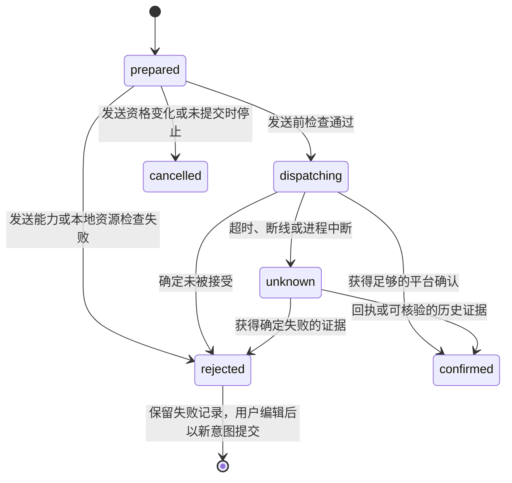

# 数据与任务设计

> Workflow 扩展已移除，本文中与 Workflow 相关的内容仅为历史记录，见[本地扩展开发](extension-development.md#workflow-已移除)。

版本：v0.7  
方案日期：2026-09-07  
状态：已提供拼多多首版实现；实际交付、验证证据与待实测项见[实现与验证记录](implementation-status.md)。

## 1. 数据归属与目录

业务库使用本地 LibSQL，通过 Prisma 7.x 与 `@prisma/adapter-libsql` 访问。运行时使用明确的本地 `file:` URL，首版不配置远程同步地址。Prisma 的 SQLite 连接能力与驱动适配参见[官方连接器文档](https://docs.prisma.io/docs/orm/v7/core-concepts/supported-databases/sqlite)。

实际用户数据位于 `app.getPath('userData')` 下的专用子目录，避免写入安装目录、源代码目录或 ASAR。绝对路径由主进程解析并传给业务进程，处理 Windows 路径、空格和中文字符。

```text
<userData>/
  judesk-data/
    db/
      judesk.db              # 业务权威数据，Prisma 管理
      mastra.db              # Mastra 状态与向量，Mastra 管理
    attachments/             # 受控附件与下载缓存
    extensions/              # Toolkit / Workflow 的不可变本地产物、manifest 和校验清单
    sandbox/                 # 调试用隔离数据、附件与 Memory，可按策略清理
    secrets/                 # 系统加密后的模型及扩展配置凭据
    logs/                    # 脱敏且轮转的本地日志
    backups/                 # 带版本与完整性清单的备份
    tmp/                     # 可清理临时文件
```

Chromium session 数据由 Electron 管理，账号表仅保存分区映射。它与可导出的业务资料分开处理。目录设置依据见 [Electron app](https://www.electronjs.org/docs/latest/api/app)。

`judesk.db` 中的表由 Prisma schema 和业务迁移管理；`mastra.db` 中的框架表由 Mastra 管理。业务状态与索引之间用持久化任务保持最终一致，不跨两个文件假定存在一笔原子事务。

## 2. 标识与时间约定

- 本地主键使用字符串 UUID；平台 ID 全部按字符串保存，避免 JavaScript 数字精度造成标识变化。
- 时间保存为统一的 UTC 时间表示，界面按用户时区展示。平台原始时间和本机接收时间分别保留。
- 金额类信息在接入时统一单位，优先使用最小货币单位整数，避免浮点计算；尚未实现的交易能力不提前创建写操作接口。
- `Store` 表示店铺，`Account` 表示登录身份。一个店铺可以有多个客服账号，不能把店铺 ID 当作登录账号 ID。
- `Conversation` 表示店铺内的逻辑会话，`ConversationRoute` 表示当前可执行该会话操作的账号通道。
- 平台具有稳定会话 ID 时优先使用；只有买家 ID 时，必须结合平台的商品或线程语义建立确定性会话键，不能无条件按买家合并。
- 同一逻辑消息被多个客服账号接收时，保留各自接收记录，尽可能归并为一个消息实体。无法证明属于同一会话或消息时，不做破坏性合并。

## 3. 核心逻辑实体

表名为建议的 Prisma model 名，字段列表说明关键约束，不是完整 schema。单机资料库不建立 Organization、Member、团队 Workspace 或 AppKey 表。

### 3.1 客服业务与学习实体

| 实体 | 核心字段 | 作用与约束 |
| --- | --- | --- |
| Store | id、platform、externalStoreId、name、replyConfigEpoch、learningConfigEpoch | `platform + externalStoreId` 唯一；店铺是知识默认隔离范围，两个代次标记当前有效角色配置 |
| Account | id、storeId、externalAccountId、sessionPartition、status | 同店铺登录身份唯一，分区唯一；保存实际身份核验结果 |
| Conversation | id、storeId、externalConversationKey、buyerId、revision、openedByHuman、awaitingHuman、humanSentAfterHandoff | `storeId + externalConversationKey` 唯一；revision 随接管、转人工、消息变化和交还 AI 递增；查看不递增 |
| ConversationRoute | conversationId、accountId、routingEpoch、status | 同一会话只有一个自动发送归属；变更时递增路由版本 |
| Message | id、conversationId、externalMessageId、dedupKey、direction、senderKind、content、receivedAt | `dedupKey` 唯一；保留平台时间、类型与规范化正文 |
| MessageReceipt | messageId、accountId、externalEventKey、receivedAt | `accountId + externalEventKey` 唯一；事件键包含事件类型与必要版本 |
| MessageGroup | id、conversationId、messageIds、revision、sealedAt | 人工和自动接待都会建立的问题集合，用于合并连续消息及回答关联 |
| AnsweredTurn | id、storeId、conversationId、questionGroupId、sourceRevision、status、answeredAt | 问题与实际回答的回合；未回答先等待，补充和纠正更新来源版本 |
| TurnAnswer | id、turnId、messageId、replyOrigin、channel、outboundId、aiRunId、supersedesAnswerId | 回答消息与回合的关联；`turnId + messageId` 唯一，可保存 AI 后接人工纠正 |
| BusinessEvent | id、sequence、storeId、type、aggregateId、sourceRevision、eventKey、learningCaptureEpoch | 持久化业务事件；eventKey 唯一，采集代次标记事件是否位于在线学习范围 |
| PlatformCursor | accountId、channel、cursor、lastCommittedAt | 仅在对应消息持久化后推进游标 |
| Attachment | id、messageId、relativePath、mimeType、size、hash | 校验目录边界和文件类型；业务记录存相对路径 |
| ReplyPolicy | id、storeId、autoReplyEnabled、directMatchThreshold、schedule、limits、version | 店铺级自动回复开关与直答分数线，默认 0.6 |
| LearningPolicy | id、storeId、autoLearnEnabled、version、enableEpoch、builtinModelRef | 独立学习开关和采集范围，不设每日调用次数上限；只引用内置学习 Agent 可用的模型，不能绑定用户编排；enableEpoch 阻止关停后的旧任务提交新建议，不代替审批 |
| LearningSubscription | storeId、eventCursor、captureBoundary、status | 恢复在线学习的事件进度和用户启停边界；关闭期间的历史不默认补学 |
| LearningEvaluation | id、storeId、turnId、sourceRevision、evaluatorVersion、jobId、aiRunId、workflowRunId、runConfigSnapshotId、inputSnapshot、status、verdicts、evidence、usage | 版本化评估，唯一键为店铺、回合、来源版本、评估器版本的组合 |
| KnowledgeCandidate | id、storeId、evaluationId、actionIndex、candidateVersion、contentHash、targetEntryId、intent、answerKind、answer、imageAttachmentId、scope、status | 统一待人工审批的学习建议，版本化保存内容、条件、来源与变更差异 |
| KnowledgeReview | id、candidateId、candidateVersion、contentHash、sourceRevision、expectedActiveRevisionId、reviewerId、reviewedAt、decision、reason、requestId | 审批记录绑定人和具体版本；requestId 去重，不接受 Agent 创建批准记录 |
| KnowledgeChange | id、evaluationId、candidateId、candidateVersion、approvalId、applyKey、expectedActiveRevisionId、status、resultRevisionId | 仅为人工已批准建议创建发布记录；applyKey 唯一，记录执行、冲突与最终版本 |
| AiRun | id、jobId、storeId、conversationId、role、mode、path、runConfigSnapshotId、workflowRunId、model、status、replySnapshot | role 区分 reply / learning，mode 区分 production / debug；path 为 direct_match / agent / workflow；回复保存命中与最终内容，学习关联 LearningEvaluation；debug 写入隔离存储 |
| Job | id、kind、dedupKey、status、runAfter、leaseToken、leaseUntil、attempts、runConfigSnapshotId | 持久化可恢复任务，条件更新领取与完成；需要 AI 的任务在首次执行时绑定快照 |
| OutboundMessage | id、intentKey、conversationId、accountId、questionGroupId、replyOrigin、aiRunId、runConfigSnapshotId、body、status | `intentKey` 唯一；保存触发问题与来源，确认后关联学习回合 |
| KnowledgeEntry | id、storeId、scope、status、activeRevisionId | 知识条目身份与状态；storeId=null 表示通用，其他值为店铺专属；enabled / disabled 可直接删除为 deleted，不能恢复。删除不物理清除历史修订与共用附件，避免破坏旧消息和引用记录；不再提供 archived 状态 |
| KnowledgeRevision | id、entryId、version、intent、answerKind、answer、imageAttachmentId、reviewStatus、approvalSource、approvalId、evaluationId、importBatchId、validUntil | `answerKind` 为 `text` 或 `image`；人工新建 / 编辑 / 导入校验后直接发布；学习结果仅在批准后创建；修订不可原地覆盖 |
| KnowledgeSource | revisionId、turnId、messageId、sourceKind、rootSourceId、verifiedAt | `sourceKind` 含 `manual`、`import`、`learning` 等；保存问答、评估及独立根依据 |
| KnowledgeImportBatch | id、storeId、fileName、status、total、succeeded、failed、createdAt | 一次本店导入任务；失败行保留原因，不把部分成功报成全部成功 |
| KnowledgeIndexRecord | revisionId、embeddingProfileId、vectorId、contentHash、status | 记录业务版本与向量索引的对应关系 |
| ModelProfile | id、provider、model、baseUrl、secretRef、limits、revision | 回复 Agent 发布时复制非密钥模型参数；学习只通过 LearningPolicy 引用内置可用模型；Embedding 单独配置；凭据只存引用 |
| AuditEvent | id、type、scope、actor、references、createdAt | 记录开关、接待、问答导入 / 编辑、学习与知识动作、Agent 发布 / 工作切换、扩展安装 / 设置变更、迁移和恢复 |

`senderKind` 区分买家、人工客服、JuDesk 自动回复、平台机器人、系统和未知来源；`replyOrigin` 进一步区分 `qa_direct`、`ai`、`human`、`handoff_notice`、`unknown`，`channel` 区分本机发送与原平台观测。方向、发送者和答案来源是不同维度。问答库的人工新建 / 编辑 / 导入在校验后直接成为本店正式知识。学习只评估 AI 临场回复和人工作答；`qa_direct` 是已有问答的原文发出，不单独评估；`handoff_notice` 只是转接提示，不属于业务回答，不形成学习回合。同一回合后来有人工纠正时再评估。学习建议只有人工审批通过并完成来源与版本校验，才成为有效知识。

接待控制分三层，店铺仍然只有开 / 关，没有辅助草稿模式：

- `ReplyPolicy.autoReplyEnabled = false`：该店铺不自动生成买家回复、不自动发送；不影响独立开关控制的学习评估。
- `openedByHuman = true`：本会话已由人工接管；点击接管或实际人工发送设置，切换页面、托盘和重启保留。
- `awaitingHuman = true`：本会话等待人工处理，不自动回复。与接管状态独立，人工处理后明确交还 AI 才清除。

具体约定：

- 当前查看 ID 只在业务进程内存保存；`conversations.open` 只更新查看与未读，不影响接待修订或在途生成。
- `conversations.reception` 携带预期 revision 显式接管或交还，拒绝覆盖期间新增的消息与转人工状态。
- 交还只接待之后的新消息，不重放旧问题，也不自动打开店铺自动回复开关。
- prepared / dispatching / unknown 发送未处理前不能交还。发送回执只确认送达，不自动交还；`humanSentAfterHandoff` 保留历史用途，不再是交还条件。
- 规则细节见[接待控制与问答优先级](reception-and-knowledge-rules.md)。

自动学习由 `LearningPolicy.autoLearnEnabled` 单独控制。买家问题归组和人工作答关联不受自动回复开关、`openedByHuman` 或 `awaitingHuman` 阻止。对学习来说，只要形成了可验证的新问答回合就可触发，不要求人工先完成「交还 AI」动作。

工作流 runId 只是执行记录。消息和知识的权威原文仍通过业务实体 ID 引用，不依赖框架内部表结构建立业务外键。

### 3.2 Agent 资产与运行快照

| 实体 | 核心字段 | 作用与约束 |
| --- | --- | --- |
| AppSetting | key、value | 本地应用设置；`developerModeEnabled` 默认 false，不控制接待资格 |
| AgentDefinition | id、name、description、origin、draftConfig、draftRevision、status | 多套本地 **回复** Agent；`origin` 为 `builtin_default` 或 `user`；默认可删除；不得声明 learning 角色 |
| AgentRevision | id、agentId、revision、configSnapshot、configHash、supportedRoles、publishedAt | 不可变发布修订，冻结指令、非密钥模型参数、Memory、限制、Skill 完整副本、资源锁和子 Agent 身份引用（兼容旧修订 ID） |
| AgentBinding | id、scopeKey、storeId、role、agentRevisionId、revision | 仅 `role = reply`；scopeKey 为 global 或 store:<id>；每个范围最多一条回复绑定 |
| AgentRevisionSubAgent | parentRevisionId、alias、childRevisionId | 父修订挂载的子回复 Agent；alias 在父修订内唯一；发布时冻结子修订并检查环路 |
| SkillDefinition | id、name、description、instructions、references、scripts、revision、status、updatedAt | 本地技能正文、参考文件与脚本，revision 乐观锁；Agent 草稿按 skillIds 挂载，发布快照完整复制内容，删除不破坏已有发布副本 |
| AssetDefinition | assetId、kind、namespace、name、description | 本地 Toolkit / Workflow 集合目录；命名空间不关联组织 |
| InstalledExtension | id、assetId、version、artifactHash、manifest、relativePath、status | 某集合的确切代码产物；成员、SDK 兼容范围、schema 和依赖随产物锁定 |
| AgentRevisionAsset | agentRevisionId、installedExtensionId、mountKind | 发布修订对 Toolkit / Workflow 的依赖引用；子 Agent 走 AgentRevisionSubAgent |
| ResourceScope | kind、resourceId、mode、storeIds、revision | 资源独立于内容版本的本地店铺授权；all/selected；空 selected 不可用 |
| AssetSetting | id、assetId、scopeKey、revision、schemaVersion、values、secretRefs | 本地默认 / 店铺覆盖的版本化设置；历史修订保留，不保存凭据明文 |
| RunConfigSnapshot | id、role、mode、storeId、accountId、conversationId、agentRevisionId、bindingId、bindingRevision、configEpoch、assetLock、resolvedSettings、modelSnapshot、policyVersions、configHash | 一次运行的有效配置；记录设置值 / 版本与 secretRef，不保存密钥明文；调试记录进入隔离库 |

AgentBinding 只允许 `role = reply`，使用非空 scopeKey 实现 `scopeKey + role` 唯一，不依赖 SQLite 对 nullable storeId 的唯一性语义。scopeKey 为 global 时 storeId 为空，为 store:<id> 时必须匹配真实店铺。没有店铺覆盖才继承全局；已有覆盖但其依赖或子 Agent 失效，不当作“没有配置”。内置学习 Agent 不写入 AgentBinding。

首次初始化创建 `origin = builtin_default` 的默认回复 Agent 并写入全局绑定。删除该 Agent 须同时解除仍指向它的绑定，并审计。一键加回按当前产品模板新建默认 Agent（新 ID）并写入全局绑定；已有店铺覆盖不变。同一资料库最多一份未删除的 `builtin_default`。启动、升级、关闭开发者模式都不得在用户未操作时重建已删默认 Agent。`developerModeEnabled` 只控制定制模块是否展示，不改变当前绑定。

AgentRevision 与资源产物不可原地覆盖。Toolkit 按工具包名称挂载，每轮开始解析最新启用版本；Workflow 仍按发布配置锁定版本。AssetSetting 每次保存生成新修订，Toolkit 设置跟随包继承。运行开始时解析当前已生效的本地默认 / 店铺设置，将实际工具版本、非密钥有效值和来源版本写入快照。回复模型参数来自 AgentRevision；学习模型只来自 LearningPolicy.builtinModelRef。Embedding 与直答阈值仍属于各自配置及 ReplyPolicy。不存在可替换的学习 Agent 入口。

绑定切换或集合设置生效，先比较提交的预期 revision，再在同一事务内更新受影响店铺的角色 configEpoch 与审计。发出任务前和提交输出时校验相应 epoch；纯草稿修改 / 发布未绑定版本不递增生产代次。角色 configEpoch 与学习开关 enableEpoch 各管一件事，两者都不能代替知识审批。

回复 RunConfigSnapshot 保存按 Agent 身份解析出的当前发布快照、子 Agent 当前发布快照、Toolkit 实际产物及完整依赖；运行中的非密钥配置固定，不重新解析。用户只按名称绑定，编号用于内部一致性和审计。高阈值直答只保存策略、Embedding、知识和 replyConfigEpoch 等必要快照，agentRevisionId 可空，不能据此记录成实际调用了某个 Agent。学习运行保存内置评估器版本与 LearningPolicy，不引用用户 AgentRevision。人工发送也不强制绑定 AI 配置。

AgentDefinition 归档不删除运行证据；被绑定或未完成任务引用的修订、产物和设置历史不得删除。历史回放找不到兼容依赖时进入可见错误，不自动使用最新版重演。审批记录的 reviewerId 可为本地操作人标识，由可信工作台操作生成，不要求组织成员或云端登录。

## 4. 索引与一致性约束

首批索引：

- 会话列表：`Conversation(storeId, updatedAt)`；待人工：`Conversation(storeId, awaitingHuman)`。
- 历史消息：`Message(conversationId, platformTimestamp, id)`，使用游标分页。
- 待执行任务：`Job(status, runAfter, priority)`；失效租约：`Job(status, leaseUntil)`。
- 待确认发送：`OutboundMessage(status, updatedAt)`。
- 学习事件：`BusinessEvent(storeId, sequence)`；回合：`AnsweredTurn(conversationId, status, answeredAt)`。
- 评估去重：`LearningEvaluation(storeId, turnId, sourceRevision, evaluatorVersion)` 唯一；发布动作 `KnowledgeChange(applyKey)` 唯一。
- 审批列表：`KnowledgeCandidate(storeId, status, updatedAt)`；候选版本、审批 requestId 和已批准动作分别建立唯一约束。
- 知识查询：`KnowledgeEntry(storeId, status)` 与修订/适用商品的关联索引。
- 审计查询：`AuditEvent(scope, createdAt)`。
- Agent 发布：`AgentRevision(agentId, revision)` 唯一；回复绑定：`AgentBinding(scopeKey, role)` 唯一且 role 仅 reply；子 Agent：`AgentRevisionSubAgent(parentRevisionId, alias)` 唯一。
- 扩展产物：`InstalledExtension(assetId, version)` 唯一并保存不可变 artifactHash；同名同版本但哈希不同的产物拒绝导入，修改代码必须递增版本。集合设置：`AssetSetting(assetId, scopeKey, revision)` 唯一。
- 运行诊断：`AiRun(storeId, role, createdAt)`、`RunConfigSnapshot(agentRevisionId)`；修订资产引用建立反向索引，卸载前同时检查工作入口与在途运行引用。

店铺与会话关系应同时在服务接口中校验，并在可表达的位置使用外键或复合约束。创建跨店铺关联必须被拒绝。SQLite 不替应用实现跨店铺授权，不能把数据隔离寄托在 ORM 默认查询上。

消息接收在一笔短事务中完成：写入投递记录、去重或更新消息、更新会话 revision、创建需要的任务、推进已确认游标。事务提交后才通知界面并确认上游投递。

平台消息去重键由适配器根据已验证的 ID 范围生成。纯粹对文本内容做哈希不足以判定重复，买家可以真实地连续发送相同文本。撤回、编辑和回执事件通过事件类型及版本单独处理。

确认一条实际回答时，在一笔业务事务中归并消息回显、更新 TurnAnswer / AnsweredTurn，并写入唯一的 `turn.answered` 或 `turn.revised` 事件。事件提交之后才唤醒 LearningLoop，避免进程退出造成“回答已保存但学习任务没有触发”。学习消费者把评估任务创建和订阅游标推进放在同一事务；即使内存通知丢失，也能从持久化事件恢复。

## 5. 本地任务调度

首版使用单业务进程中的任务调度器，任务本体存入 `judesk.db`。内存事件仅负责唤醒消费者；重启后依据数据库恢复。

任务类型至少包括：问答对匹配、生成回复、执行发送、确认发送结果、`import_qa_pairs`（本店问答导入，含图片落盘）、`evaluate_answered_turn`（逐轮学习评估）、`apply_knowledge_change`（执行已人工批准的知识发布）、构建向量、清理索引和同步历史。在线学习由回答事件触发；问答库导入与历史聊天导入是不同任务。

| 状态 | 含义 | 允许的后续动作 |
| --- | --- | --- |
| pending | 等待执行 | 条件领取后进入 running，或取消 |
| running | 已领取且租约有效 | 成功、重试、失败、取消或等待确认 |
| retry_wait | 确定可以重试，等待退避 | 到时重新领取；执行前复核业务状态 |
| waiting_confirmation | 外部副作用结果不明 | 查询或人工确认结果；不直接重复执行副作用 |
| succeeded | 任务完成 | 保留必要结果，按策略归档 |
| failed | 确定失败或超过重试限制 | 可展示修复入口；重新执行仍需去重和复核 |
| cancelled | 已被人工打开、转人工、替代或过期 | 不恢复原任务的发送权 |

领取任务时，使用带预期状态的条件更新取得租约，写入 `leaseToken`、持有者和期限。续约与完成更新都要求令牌匹配，过期执行者的结果不能覆盖新执行状态。

同一会话的回复与发送串行化；不同会话有限并发，按店铺和模型供应商进一步限流。同一学习回合的来源版本串行评估，不同回合有限并发；实时接待优先于在线学习，在线学习优先于历史导入，学习积压必须可见。

初始调试参数可以设置为：全局最多 2 个生成请求、每店铺最多 1 个发送、全局最多 1 个学习任务，后续以容量测试调整。它们是起步配置，不代表平台许可配额或性能承诺。

AI 任务首次开始时解析工作绑定并创建配置快照；重试仍引用原快照，恢复前核对当前 configEpoch 与依赖是否允许继续。配置已切换的未发送回复取消后按正常接待资格重排，不能把新修订加进 intentKey 产生重复回答。未完成的旧学习任务在提交前发现配置切换时取消旧执行并按当前来源重排；同一配置指纹仍用原稳定键去重。

查询和纯计算失败可以有限重试；网络调用不放在数据库事务内。外部发送发生过或是否发生无法证明的任务，即使租约失效也进入结果确认流程。

## 6. 发送意图与状态机

`OutboundMessage` 是人工和 AI 的共同发送入口。人工操作使用稳定的用户操作 ID；AI 意图键绑定会话、触发消息组和回复用途，不能绑定每次随机生成的模型 runId。

人工文本使用异步提交：点击发送即以 `manual:<requestId>` 在当前会话显示乐观气泡并清空文本草稿；服务将 OutboundMessage 落库后立即返回，平台调用在业务进程后台进行。同一会话的文本串行发送，不同会话独立执行。重复 requestId 返回同一记录，且不能更换会话或内容。当前图片上传与发送仍使用原有等待结果的入口。

聊天界面通过 `conversations.outbounds` 读取当前会话近期人工发送记录，与实际 Message 合并显示。`prepared` 和 `dispatching` 显示“发送中”，`confirmed` 显示“已发送”，`rejected` / `cancelled` 显示“发送失败”及原因；确定失败的文本可重新放入输入框编辑。`unknown` 显示“发送待确认”，要求核对平台记录，不提供自动重发。前端状态跨页面 / 会话切换保留，服务事件更新后由持久化记录替换乐观状态。

只有精确 externalId 或 Message.raw.confirmedOutboundId 能将平台消息与本机气泡归并，不用相同文本推测同一消息。气泡按发送意图时间显示，保留 IPC Date 对象的毫秒精度；平台回执到达时不新增重复气泡。等待中的 OutboundMessage 不写入正式 Message，也不会进入自动学习；只有确认成功后创建 / 归并真实消息并采集学习来源。已确认的前序排队回复可按照提交时间参与连续回答合并，但尚未确认的草稿和提交后才到达的买家问题不能成为该回答的学习来源。

人工意图入队时取消旧的自动回复资格。已离开会话但人工文本仍在排队 / 等待平台时，新买家输入不触发 AI 抢答。正常停止后取消尚未提交平台的队列项；重启继续遵循原规则，将中断的 dispatching 标记 unknown、未提交的 prepared 标记 cancelled，不自动重放消息。本次修改复用现有表，无数据库结构迁移。

Agent 转人工时，等待人工状态、当前 Job / AiRun 成功结果与 `handoff_notice` 发送意图在同一事务中提交。当前实现的来源字段为 `origin`，转接提示键为 `handoff:<conversationId>:<groupId>`，与普通回复用途区分。其发送成败单独记录，不能回滚人工等待或把已成功的转人工记成 STALE。提示不关联问题组为已回答，不产生学习事件，也不能满足人工实际回复条件。



`confirmed` 表示平台已接受或回显这条发送，不表示买家已经阅读。具体确认等级由适配器声明并保存在记录中。只有具备实际回答证据并完成问题关联的发送，才能形成学习回合；原平台人工回复通过可验证的消息事件走同样的回合关联流程。

发送前检查：

1. 店铺策略仍允许本次操作，账号在线且会话归属有效。
2. 当前 conversation revision、routingEpoch、策略版本与生成回复所依据的版本匹配。
3. 店铺仍开启自动回复，该会话当前未被人工接管且未等待人工，触发消息尚未被回应或由新任务替代；replyConfigEpoch 与本次快照一致，Agent 路径的绑定与依赖仍有效。
4. 直答时命中问答对仍有效且分数仍高于阈值；Agent 发送时引用的知识或附件仍有效，并符合已验证的平台能力。
5. 不存在相同意图的已确认或结果未知发送。

上述未等待人工限制适用于普通自动回复。`handoff_notice` 必须匹配转人工后的 revision 且仍处于等待人工；人工打开、新输入、账号失效或关闭开关同样阻止未提交提示。

业务进程先持久化 `dispatching` 和执行令牌，再委托实际发送。主进程的网页宿主按令牌和当前路由执行一次，拒绝旧服务实例或失效路由的命令。

本机「打开会话」「转人工」与发送命令通过同一会话的串行控制入口处理。接管或转人工写入成功意味着后续尚未提交的自动发送已被阻止；此前已进入平台通道的请求无法无条件撤回。

交回 AI 之后，只对之后新到达的买家消息恢复自动回复，不重放暂停或等待期间取消的旧答案。查看和离开不改变接待状态；只有显式交还才恢复。平台原生端的人工作答也只能在被观察到后影响本机状态，验收中必须明确这段竞态窗口。

发送结果不明时，不以“查询历史暂时没找到”推断失败。需要稳定的回执、平台支持的幂等请求或足够的对账证据；否则保留待确认状态，并交由用户处理。该设计不承诺跨平台严格 exactly-once。

## 7. Mastra 与业务状态恢复

Mastra 使用本地 LibSQLStore 保存记忆与工作流状态。快照支持挂起和恢复，参见 [Mastra snapshots](https://mastra.ai/docs/workflows/snapshots)。具体快照时机以锁定版本实测为准，不能假定任意代码执行位置都已经持久化。

应用启动时根据 Job、OutboundMessage、AiRun、RunConfigSnapshot、AnsweredTurn 和 LearningEvaluation 判断恢复策略：

- 可重算的纯查询、候选回复和提取任务可以重新执行，但重新检查触发条件。
- 已知挂起且可恢复的工作流用保存的 runId 及原 Agent / Workflow 代码与设置快照恢复；先复核角色配置代次，不能原地套用新的工作绑定。
- 有外部发送记录的任务先确认发送状态，再决定后续工作。
- 旧版本工作流无法安全恢复时，保留诊断信息，取消或重建无副作用步骤；不重放发送。
- LearningLoop 从订阅游标和积压任务恢复，检查学习开关、启用代次与来源版本，避免重复创建建议。审批队列恢复待审批 / 已拒绝状态；发布任务必须找到有效的人工作业 approvalId，不能把重启或重试当作批准。

### 7.1 回合关联与来源版本

AnsweredTurn 的状态至少包括 waiting_answer、collecting、answered、needs_association、invalidated。首次问题入库建立 waiting_answer；实际回答到达后立即进入收集 / 可评估流程，可用有最长等待限制的短窗口归并一段文字加图片，不等待会话结束。

`questionGroupId` 指向本轮买家输入。TurnAnswer 将一条或多条实际回答关联到回合，保留来源、当时的匹配 / AI 证据快照和纠正关系。默认不把同一回答关联到多个回合；有明确引用关系且一个回复覆盖多问时保存每个关联的依据。

同一物理消息的本机确认和平台回显先归并为同一个 Message，再建立 TurnAnswer；重复观测不会增加 sourceRevision。实质性的补充、编辑、撤回或明确的纠正才递增版本，并使相关未发布候选及旧批准失效，重新评估后仍须人工审批。

人工实际回复无需人工先配对：本机人工发送取得精确成功回执、或平台观测到可归因的人工作答后，自动创建 `associationMode=conversation_context` 的学习回合。`questionGroupId` 对应的是本轮候选买家消息，`contextMessageIds` 保存当时可见的上下文 ID，不声称所有候选问题都已得到回答；内置学习 Agent 在同一次评估中判断对应关系，不确定时不提取。

人工上下文按同会话最近 24 小时、最多 40 条近期有效文字 / 图片消息收集，候选问题取最近一次买家输入段；连续补充时另外保留本轮原始候选问题 ID，避免连续回复挤出问题来源。连续人工补充在无新买家消息、相邻间隔不超过 5 分钟且学习采集代次相同的情况下复用回合，递增来源版本；最新回复后至少保留 2.5 秒收集时间，未开始的旧版本不发起模型请求。超过收集范围且无可验证买家上下文的主动招呼标记 `no_question_context`，不伪造问答或要求人工配对。

本机发送以 OutboundMessage 创建时间冻结可见范围；迟到回执不会纳入发送意图之后才收到的问题。平台人工回复同时依据平台时间与本机接收时间限制范围。上下文引用的消息被撤回时同样使回合和未发布建议失效。AI / 问答直答保留 `associationMode=explicit` 的明确来源。旧版待关联人工消息不因升级或开启学习被回扫；旧版异常人工关联接口仅保留兼容，不再是正常人工回复的学习前置步骤。

### 7.2 学习订阅与候选生成

LearningPolicy 的开关与接待状态独立。回合事实事件始终入库；事务内读取学习开关并保存 learningCaptureEpoch，消费时据此判定在线采集范围。关闭学习后停止新评估任务和候选提交，保存此前积压。进程意外退出且用户开关仍开启时补处理可恢复事件；主动关闭期间的历史不默认全量补学。

学习评估的稳定键为 `storeId + turnId + sourceRevision + evaluatorVersion`，评估器版本由内置学习 Agent 版本、LearningPolicy 模型引用、评估规则和非密钥设置生成指纹，不包含用户回复编排。策略版本、learningConfigEpoch 与 enableEpoch 随任务保存，提交候选前检查；指纹不以开关代次或随机 runId 代替。来源已变时用新版本重评，单纯启停不把同一答案算作新的独立学习证据。内置学习版本或策略变更只影响新任务和需重排的未完成任务，已完成评估、已有候选及批准记录保留当时配置；不默认重评全部历史，也不因切换回复 Agent 自动批准或废弃已有建议。

每个评估结果记录对应来源版本的输入快照、回答来源、匹配判断、合理性、可复用性、证据和用量。快照的删除与保留服从原消息的数据清理要求。KnowledgeCandidate 保存具体修改建议和不可混淆的候选版本；同一 evaluationId、动作和候选版本只生成一条待审批记录。

完成候选保存后本轮学习任务即可结束，不等待人工、不长期持有任务租约。学习报告和建议不修改生产知识、匹配阈值、排序或启停状态，也不被回复 Agent 当作已生效的资料读取。

### 7.3 人工审批与知识发布

审批接口由工作台的人工作业调用，提供 `approveLearningCandidate`、`editAndApproveLearningCandidate` 和 `rejectLearningCandidate`，不注册为 AI 工具。调用携带 candidateId、candidateVersion、contentHash、预期源版本及目标知识版本；审批者从受控人工作业上下文获取。

KnowledgeCandidate 的状态为 pending_review、approved、rejected 或 stale。批准或拒绝均写入 KnowledgeReview，保留时间、身份、意见和具体内容版本。编辑产生新候选版本，只有人明确批准编辑后的内容才算审批通过。相同 requestId 的重复点击只产生同一次审批操作。

批准事务核对候选仍待审批且版本一致、来源有效、店铺范围正确、附件可用、目标 activeRevisionId 未变化。通过后将候选标为 approved，写入 decision = approved 的审批记录，并在同一事务创建 KnowledgeChange 与发布任务。拒绝仅记录 rejected 状态与原因，不生成发布或生产索引任务。

KnowledgeChange 的 applyKey 绑定 approvalId、candidateVersion 和动作标识。执行发布任务时再次校验批准内容、来源版本、目标版本及审批状态，成功后在短事务中写正式知识修订或应用获批停用、来源关系、发布结果和索引任务。正式修订保存 `approvalSource = human`、approvalId、evaluationId。

任何内容变化、人工对目标知识的新修改或来源失效，都会使未提交的旧批准不能继续执行。对应候选 / 发布记录标记 stale 或 conflicted，生成新建议后重新审批，不能自动迁移旧批准到新版本。已发布修订保持不可变，新一轮学习需要新的批准。

待审批、被拒绝或过期的建议均不参与生产检索和自动回复，重启和重试不能改变这个限制。先前已经生效的知识在建议待审批期间继续按原规则使用。即使建议来自人工作答、模型评分很高或与现有答案近似，也不存在自动批准路径。

关闭自动学习仅停止继续评估与生成建议；已有待审批建议仍可人工批准或拒绝，已批准且有效的发布 / 索引任务可继续执行。发布校验依赖审批记录和数据版本，不把 autoLearnEnabled 或 enableEpoch 当作人工批准的替代条件。

学习 Agent 发现疑似错误、范围不合适或来源冲突时只创建报告与待审批的修订 / 停用建议。实际消息删除、撤回、附件缺失或有效期届满属于可确定的数据失效，按原业务规则过滤并保留最小复核记录；不能把模型判断等同于事实失效而绕过人工审批。基于学习结果重新启用或替换知识同样需要批准。

## 8. 知识与向量的一致性

知识写入分两条人工作业路径，都不需要开发者模式：

- 问答库新建 / 编辑 / 导入：用户对当前店铺直接维护「意图-回答」或「意图-图片」。校验通过后创建正式 KnowledgeRevision，`sourceKind` 为 `manual` 或 `import`，并安排索引。导入按 KnowledgeImportBatch 记录对账，图片先落入 attachments 再引用 `imageAttachmentId`。
- 学习建议：只有人工批准且通过发布校验后，才能更新 activeRevisionId 并创建生产索引任务，记录 approvalSource、approvalId 和 evaluationId。

向量写入完成后更新 KnowledgeIndexRecord；待审批、被拒绝或审批过期的学习候选没有生产索引资格。人工已发布的问答对立即参与检索。

向量 ID 根据修订 ID、意图文本和 Embedding 配置确定，重复构建执行 upsert。查询命中后必须回查业务库，确认店铺、适用范围、生效版本、有效期和答案类型；学习产生的知识还必须有绑定该版本的有效人工批准记录。补齐同意图和明确覆盖规则后，超过 `directMatchThreshold` 且无不同答案或适用条件歧义才直答；其他情况交给现有回复 Agent。

经人工批准的停用或业务规则确认的实际来源失效，即使向量清理尚未完成，也会被业务校验过滤。清理、重建和配置迁移均可断点续做。审批与知识变更事件只安排发布、索引或必要复核，不生成新的 `turn.answered`，避免学习循环自我触发。

Embedding 配置包含模型标识、维度和文本处理版本。更换配置时建立新索引，待构建和检索评估通过后切换；即使向量维度相同，不同模型的向量也不能混用。

## 9. 数据库运行参数

业务库启用并校验 WAL、外键和适当的 busy timeout。关键消息与发送意图优先使用保证提交持久性的同步配置，吞吐量优化不得无说明地降低断电时的持久性。

所有连接的参数要在真实驱动下核实，包括 Prisma adapter 创建的连接。数据库级与连接级参数不能混为一谈。长时间模型请求、文件下载和人工等待均在事务外执行。

SQLite 的 WAL 允许读写并行，但同一文件同时只有一个写入者；活跃 WAL 数据库不通过网盘或网络文件系统被多机器共享。引擎版本、原生库来源和 WAL 相关修复纳入依赖兼容记录。依据见 [SQLite WAL](https://www.sqlite.org/wal.html)。

## 10. Schema 迁移

本节以 Prisma 7.x 的 Prisma Migrate 为基线。开发阶段生成和审查 SQL 迁移，迁移文件提交到仓库。普通用户启动应用时不执行 `migrate dev`、`db push` 或数据库重置。

首版优先封装固定版本的 Prisma 7.x `migrate deploy` 执行器，随安装包携带所需配置、迁移文件及该版本要求的运行资源，由受控子进程针对本地业务库执行。Prisma Client 在构建阶段生成。用户无需另装 Node.js、Prisma CLI，也不在运行时下载迁移工具。

这一封装方式是 M0 的阻断性验证项，包括 Electron 子进程兼容性、原生资源路径、离线执行和包体影响。若不能可靠分发，必须先变更迁移设计再进入业务开发，不能临时改为用户数据库上的 `db push`。

启动迁移顺序：停止接待和数据库使用者 → 检查 schema 兼容范围 → 创建一致备份 → 执行迁移 → 验证外键和关键查询 → 初始化兼容版本的 Mastra 存储 → 恢复服务。

应用保存可读取的 schema 范围、迁移记录和 AI 存储版本。Mastra 自身升级涉及的 schema 或状态格式也要纳入兼容验证，不能只迁移 Prisma 表。

迁移失败后停止业务写入并提供修复/恢复入口。不假定每条 DDL 都能自动回滚，也不自动让旧程序打开不兼容的新 schema。降级使用匹配版本的备份或经过验证的迁移方案。

参考 [Prisma CLI](https://docs.prisma.io/docs/orm/v7/reference/prisma-cli-reference) 和 [Prisma 迁移工作流](https://docs.prisma.io/docs/orm/v7/prisma-migrate/workflows/development-and-production)。

## 11. 备份、恢复与保留策略

应用备份先停止领取任务和外部发送，等待或登记正在执行的操作，暂停相关写入后再生成两个库的一致备份集。文件级快照须使用所选 LibSQL 版本支持并验证过的备份方法；SQLite 提供 Online Backup API 和 `VACUUM INTO` 等机制，但 JS 驱动是否直接暴露对应 API 需要确认。

不能在活跃写入时只复制一个 `.db` 文件并忽略 WAL。备份清单记录应用版本、schema 版本、Mastra 版本、Embedding 配置、Agent 绑定 / 修订、扩展产物 / 设置版本、附件清单和校验值。需要任务恢复的扩展产物必须包含在备份集中，或提供可验证的相同哈希恢复来源；普通配置导出不等同于完整备份。保存诊断或备份失败不应删除原始数据。

恢复在服务停止时进行：校验清单与版本、保留当前数据副本、恢复文件、检查关系、确认账号身份、核对待发送记录，最后再启用接待。恢复旧备份后，平台可能已经收到备份时间之后的回复，因此所有可能重放的发送都要重新对账。

业务导出默认不包含 Cookie 和模型密钥。复制账号浏览器目录或加密凭据不等于能在另一台电脑直接登录，导入后应重新验证或重新登录。

原始消息、审计、框架 trace 和附件分别配置保留周期。清理前检查待执行任务和知识来源引用；删除知识时同步安排索引清理。长期保留策略由用户选择，首版不得暗中永久保存全部模型请求正文。

参考 [SQLite 备份](https://www.sqlite.org/backup.html) 和 [Electron safeStorage](https://www.electronjs.org/docs/latest/api/safe-storage)。


## 拼多多 Toolkit v2 增量（2026-09-08）

`PlatformEvidence` 保存实际返回给回复 Agent 的有限结构化平台资料，包含 runId、storeId、accountId、conversationId、buyerId、operation、subjectId、queryKey、input、result、observedAt；同 runId/queryKey 唯一。结果不可原地覆盖，不跨运行缓存。学习只接受本回合相关成功回复中已引用、同范围且回答前取得的事实。

`PlatformAction` 保存 order-remark 的 runId、范围、targetId、sourceEvidenceId、dedupKey、input、preview、result 和状态。prepared 在宿主提交前授权时变为 dispatched，最终保存 confirmed / rejected / unknown。持久化去重键由店铺、买家、最后一条本轮买家消息、目标订单和规范化备注组成，不依赖模型自己提供的 idempotency key。中断留下的 prepared/dispatched 同样禁止自动重派；重复请求返回未确认。该状态机独立于消息发送 OutboundMessage。

迁移 `202609080004_pdd_toolkit` 为纯增量建表，与 AiRun 建立删除级联；不改写既有 Agent、模型、绑定、消息和订单。操作日志存储在本机数据库，随现有备份一起保存。
