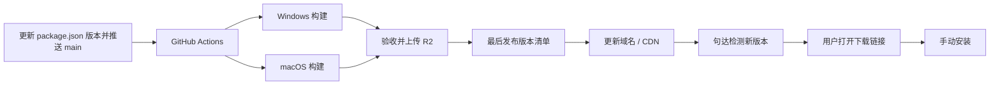

# 句达桌面端自动发版与更新方案

日期：2026-09-20。状态：技术方案，尚未实现或配置云资源。用户已确定 Windows 与 macOS 同时支持。

## 选型结论

采用 **GitHub Actions + electron-builder + Cloudflare R2 + 自有更新域名**。第一阶段使用通用 HTTPS 清单检测版本，用户打开 Windows `.exe` 或 macOS `.dmg` 下载链接后手动安装；第二阶段补齐签名凭据后，再启用 `electron-updater` 一键下载和重启。R2 的 S3 兼容接口只用于 CI 上传，客户端通过自定义域名走公开 HTTPS 读取；不把 R2 的 Access Key 放进安装包。

发布者修改 `package.json` 版本并推送到 `main`，流水线检测到版本变化后完成构建、验收和上传；用户在句达内看到新版本，点击下载链接后手动完成安装。软件更新无需登录云端账号。签名凭据准备好后，workflow 的 `signed=true` 模式和客户端自动更新模块可以切换到「更新并重启」。



electron-updater 官方支持 NSIS 更新、macOS 更新及 generic HTTPS 更新源；generic 更新源的文件上传由我们的发版脚本完成。[自动更新说明](https://www.electron.build/v26/docs/features/auto-update/)、[发布配置](https://www.electron.build/v26/docs/publish/)。实现以仓库现有 electron-builder 26.15.3 为基线，锁定并验证配套 updater 版本，不在本功能中顺带升级整个打包工具链。

## 当前代码与改造边界

| 当前情况 | 实施内容 |
| --- | --- |
| 根 package.json 版本为 0.1.0，已使用 electron-builder，没有 electron-updater | 增加主进程更新模块，版本统一取 package.json / app.getVersion() |
| Windows 只产出 x64 ZIP | 改为 NSIS 完整安装包，使用每用户安装；第一阶段作为手动下载载体，签名后可作为自动更新载体 |
| macOS 产出 DMG + ZIP，identity 为 null | 保留两种产物；第一阶段使用 DMG 手动安装，签名后接入 Developer ID 签名和公证 |
| 无 .github 发版工作流，两个项目 origin 均在 GitHub | 新建构建、验收、发布流水线 |
| SDK 使用 file:../judesk-license/packages/client | CI 检出两个仓库，固定 SDK 所在仓库的提交；构建 SDK 后安装桌面依赖 |
| 退出先关闭平台，再停止服务，8 秒后可能强杀 | 增加专门的更新准备与退出握手，避免直接复用强杀路径 |
| 启动已执行 Prisma migrate deploy | 补充迁移前自动备份、迁移状态与失败恢复入口 |
| 手动备份依赖保存对话框，备份生成/校验都写死 0.1.0 | 抽取自动快照服务，将备份格式版本、数据库版本与应用版本分别记录 |

judesk-license 继续负责账号和云端计费。第一阶段不新增更新数据库表、版本管理后台、账号授权下载或自建差分补丁服务。

## 系统与安装包

| 系统 | 首次安装 | 后续更新 | 正式发布要求 |
| --- | --- | --- | --- |
| Windows x64 | 签名的 NSIS .exe | electron-updater 下载并安装 NSIS 包 | Authenticode 签名、发布者校验、时间戳 |
| macOS Apple Silicon | 签名并公证的 .dmg | 下载同架构签名 .zip 并替换应用 | Developer ID Application、Hardened Runtime、公证及适用产物的 stapling |
| macOS Intel | 签名并公证的 .dmg | 下载同架构签名 .zip 并替换应用 | 与 Apple Silicon 相同，独立构建与验收 |

Windows 选择 oneClick、perMachine=false 的安装方式，尽量减少权限提示；仍以操作系统权限和安全策略为准。macOS 支持从正常安装位置更新，不把挂载 DMG 内直接运行当作已安装状态。[NSIS 配置](https://www.electron.build/v26/docs/nsis/)。

macOS 自动更新需要有效签名；正式站外分发同时完成公证。Windows 签名虽不是 NSIS 生成安装包的硬性要求，本方案将其作为正式自动更新发布条件，以校验发布者身份；不承诺签名后绝不会出现系统信誉提示。[签名与公证说明](https://www.electron.build/v26/docs/features/code-signing/)。

保留当前 appId `cn.judesk.desktop`、应用名称、数据目录及系统密钥存储标识。安装替换程序文件，不清除用户数据库、附件、模型配置、云端凭据和平台登录数据；这些保留行为必须通过两版安装包真实升级验证。

**现有用户必须手动安装一次带更新能力的新版。** 当前旧版没有检查更新代码，服务端上传包无法让它自行获得更新能力。第一版仍可通过现有夸克渠道通知，下载入口同时迁移到官网；后续通过软件内更新。

## R2 存储和更新域名

拟使用 `https://updates.quantaflow.one`，该域名尚未配置。官网提供首次安装的下载入口，应用使用同域名读取更新文件。

使用单独的 R2 Bucket，例如 `judesk-releases`。将 `updates.quantaflow.one` 作为 R2 Custom Domain 连接到该 Bucket，客户端匿名读取发布文件，R2 的写权限只给 GitHub Actions。R2 的 `r2.dev` 公共地址仅用于联调，生产环境使用自定义域名；不要让客户端直接访问 R2 S3 API，也不要使用需要签名的私有下载链接。[R2 公共 Bucket 与自定义域名](https://developers.cloudflare.com/r2/buckets/public-buckets/)。

CI 使用 Cloudflare R2 的 S3 兼容 endpoint 上传：`https://<ACCOUNT_ID>.r2.cloudflarestorage.com`，区域填 `auto`，配置仅作用于 GitHub Actions Secret。创建只绑定这个 Bucket 的 Object Read & Write token；客户端不保存 Access Key。上传工具可选 AWS CLI、rclone 或 Wrangler，本方案优先使用 AWS CLI，脚本显式传 `--endpoint-url`，避免误传到 AWS S3。[R2 S3 兼容 API](https://developers.cloudflare.com/r2/api/s3/api/)、[R2 CLI 与权限](https://developers.cloudflare.com/r2/get-started/cli/)。

R2 Custom Domain 已经经过 Cloudflare 网络访问，并可使用 Cloudflare Cache；不额外购买阿里云 CDN。生产域名需要在同一 Cloudflare 账号中管理，R2 文档要求自定义域名对应的 zone 已添加到该账号。先使用 `updates.quantaflow.one` 直连 R2 Custom Domain，下载量上来后再配置 Smart Tiered Cache 和针对安装包的 Cache Rule。[R2 缓存](https://developers.cloudflare.com/cache/interaction-cloudflare-products/r2/)。

预定目录如下，版本号仅为示例：

```text
/stable/win32/x64/
  latest.yml
  judesk-0.2.0-win32-x64.exe
  judesk-0.2.0-win32-x64.exe.blockmap
/stable/darwin/arm64/
  latest-mac.yml
  judesk-0.2.0-darwin-arm64.dmg
  judesk-0.2.0-darwin-arm64.zip
  ...构建生成的 blockmap 文件
/stable/darwin/x64/
  latest-mac.yml
  judesk-0.2.0-darwin-x64.dmg
  judesk-0.2.0-darwin-x64.zip
  ...构建生成的 blockmap 文件
```

架构分别配置构建时的 publish URL，避免两个 macOS 构建互相覆盖清单。文件名固定使用 ASCII，包含版本和架构；应用显示名仍为「句达」。清单由 builder 生成，上传脚本验证其中每个 URL 都指向实际上传对象，不手填文件哈希。

带版本号的安装包只新增、不覆盖，设置长期缓存；latest*.yml 设置 `Cache-Control: no-cache, no-store`，并在 Cloudflare Cache Rule 中排除清单路径。R2/Cloudflare 会缓存常见文件类型，安装包和 blockmap 的缓存策略要从公开域名实际验证；发布新版本时不覆盖旧包，清单全部上传后才公开新版本号。上线后检查清单、哈希、大小和 Range 响应。差分下载采用 updater 原生能力，失败允许回退完整包；不把固定节省比例作为承诺。Cloudflare 支持 Range 请求，但仍需用目标文件实测，必要时配置 `useMultipleRangeRequest=false`。[R2 Range 与缓存说明](https://developers.cloudflare.com/cache/reference/range-requests/)、[Generic 更新源配置](https://www.electron.build/docs/api/builder-util-runtime.interface.genericserveroptions/)。

现有 Caddy 静态目录也能提供同类更新源，可用于联调或临时过渡；正式分发默认放 R2，避免安装包下载占用账号和模型服务的服务器带宽。R2 不收取互联网出口流量费，成本主要来自存储、Class A/B 操作、CI 和签名服务；仍按实际包大小与用户下载量评估请求次数和缓存命中率。[R2 价格说明](https://developers.cloudflare.com/r2/pricing/)

## 发版流程

1. 更新 package.json 版本和更新说明，提交并推送到 `main`；只有版本号发生变化时才会触发构建。提供 workflow_dispatch 作为重新执行入口。
2. 锁定桌面代码、SDK 代码提交、pnpm 锁文件和工具链版本。两个私有仓库的检出权限仅存在 CI，不进入安装包。
3. 使用 Windows x64、macOS arm64、macOS x64 对应构建环境，各自安装原生依赖、运行类型检查与相关测试、打包并签名。不得把在 macOS 上交叉生成 Windows 包视作已完成 Windows 验收。[多平台构建限制](https://www.electron.build/v26/docs/features/multi-platform-build/)。
4. 检查安装包内 Prisma 引擎、LibSQL 原生模块、资源文件和 serverUrl 配置；执行全新安装与从上一正式版升级的验收。macOS 签名、公证失败时发布失败。
5. 上传完整安装包、ZIP、blockmap 等有版本号的对象，核实公开 URL 和 SHA-512。可以并行上传，但不让各构建任务直接覆盖正式清单。
6. 由单一发布任务在所需平台全部就绪后更新对应 latest*.yml，再复查公共源。发布任务串行化，拒绝旧流水线覆盖新版本；任何构建或上传失败均保持原正式清单。
7. 归档版本、两个仓库的提交、产物哈希、签名结果、更新说明和旧清单。官网使用同一批经过验证的下载链接。

首次上线同时提供稳定通道和隔离测试源，普通用户只使用稳定通道。后续用户量增加时再启用按比例发布；预留独立 beta 通道，不在首版增加复杂的管理界面。

## 客户端交互与进程边界

启动完成约 30 秒后检查，常驻时每 6 小时检查一次并加随机延迟，睡眠恢复后检查是否到期。设置页提供「检查更新」。网络失败仅显示可重试状态，不阻塞启动和本地功能。

第一阶段发现新版后显示版本、更新说明、包大小和「打开下载链接」。用户在浏览器下载 `.exe` 或 `.dmg`，退出句达后手动安装；检测更新不会中断接待。签名凭据准备好后，`signed=true` 构建会启用自动下载、保存数据、退出和重启流程。

状态机为：空闲 → 检查 → 发现新版 → 下载 → 已校验 → 准备退出 → 安装。错误可重试，并保留已安装版本。仅有本次明确的安装意图才能触发重启；设置 autoDownload=false、autoInstallOnAppQuit=false，避免关闭窗口或退出时意外安装。

新增主进程 UpdateManager 负责版本清单检查和固定 HTTPS 下载链接；签名模式下继续负责 updater、下载缓存和安装。界面只通过校验过的 IPC 请求查询状态、检查和打开下载链接；沿用当前 sender 与 mainFrame 检查，拒绝界面传入任意更新 URL、文件路径或命令。更新日志不含云端令牌或签名凭据。

更新 IPC 应由主进程直接处理，不依赖业务进程 ready；否则本地数据库启动失败时，用户无法获取修复版。手动模式使用固定 HTTPS 更新源和清单中的相对下载路径；签名模式再使用文件哈希和平台签名验证。哈希负责完整性，代码签名负责发布者身份，两者不能相互替代。

## 安全退出与本地数据

现有 main/index.ts 的 before-quit 先关闭平台，然后发送 shutdown，8 秒后可能 kill 服务；service 已实现 engine.stop、AI close 和数据库断开，engine.stop 会等待任务与人工发送队列。更新流程应复用这些能力并补齐可靠顺序：

1. 进入维护态，停止领取新任务，拒绝新的人工发送和写入操作；平台回执继续接收，保存已有未保存编辑。
2. 取消尚未提交的模型任务，等待已发起操作的回执，或将结果不明的发送持久化为待确认；禁止为升级重启后直接重发。
3. 等待受控请求完成，生成一致的数据库快照，记录来源版本、目标版本、迁移版本与完整性清单；备份失败或空间不足则停止安装。
4. 冲刷平台登录数据与待写文件，关闭平台、云端连接、AI 存储和数据库，收到服务停止确认并确认进程退出后调用 quitAndInstall。
5. 若准备阶段超时，推迟更新并恢复可用状态；不以 8 秒强杀作为“准备成功”。使用统一退出协调器，避免 updater 与 before-quit 互相拦截、重复退出或触发服务自动拉起。

将现有手动备份中的 VACUUM INTO 等逻辑抽成不需要选择文件的快照服务。自动升级快照覆盖两个数据库和受迁移影响的配置；附件、扩展、登录数据不因升级删除。备份跨版本兼容按格式和数据库版本判断，去掉对 appVersion=0.1.0 的硬编码限制。

新版首次启动，在业务进程和平台恢复之前检查更新状态，执行迁移并做基本健康检查；通过后才恢复任务调度和平台连接，保留原人工接管状态。普通重启正常恢复与故障恢复应分开：显式恢复旧备份时沿用现有暂停自动回复、未知发送待核查的保护规则。

迁移失败时进入恢复界面，允许查看诊断、恢复升级前数据或安装更高版本的修复包。迁移前备份同时覆盖用户手动安装新包的路径，不能只在 updater 下载后做备份。首版不承诺任何数据库变更都能自动降级；不得恢复快照后继续让不兼容的新程序运行。

## 撤回与恢复

默认禁止自动降级。同版本产物不可替换。发现坏版本后，先将公开清单恢复到上一个稳定发布以停止新的发现，并排查已经下载的安装任务；客户端在安装前重新核对发布状态，已撤回的目标停止安装。

对已经升级的用户发布更高版本的修复包；涉及数据库变更时做兼容修复，不能只把旧二进制重新上传。官网保留稳定安装包作为人工修复入口。清单恢复不能保证离线设备立即获知撤回，因此不能把它描述成所有客户端的即时远程回滚。

## 实施拆分与验收

| 工作包 | 主要位置 / 输出 |
| --- | --- |
| 安装包与签名 | electron-builder.yml、根 package.json、scripts/before-pack.cjs；三个系统/架构的签名产物 |
| 客户端更新 | 新增 apps/desktop/src/main/updater.ts，更新 main/index.ts、preload、contracts 和设置页 |
| 退出与备份 | service/index.ts、core/engine.ts、core/router.ts、core/backup.ts；退出握手、自动快照、迁移恢复 |
| 自动发布 | 新增 .github/workflows/release.yml、scripts/publish-release.mjs；上传、验包、串行发布清单 |
| 分发配置 | R2 Bucket、更新域名 HTTPS、Cloudflare 缓存与 Range 设置、官网首次下载入口 |
| 发布验收 | Windows 与两种 macOS 架构的真实安装升级记录；失败、恢复、数据保留证据 |

完成标准是从安装版 A 升到 B 后能重新运行，账号配置、平台登录、聊天、知识库、附件和人工接管状态符合预期，且没有重复发送。需覆盖离线、下载中断、损坏/签名错误的包、空间不足、版本撤回、跨版本迁移、任务执行中更新、退出超时、恢复快照、托盘与重启、连续两次升级。只运行开发模式或只看到“发现新版本”不算完成。

落地前需要落实的外部配置为：R2 Bucket、R2 Custom Domain、Cloudflare 缓存规则、R2 Object Read & Write 发版权限、Apple Developer 签名与公证凭据、支持自动化的 Windows 签名服务、CI 对 SDK 仓库的最小读取权限。凭据通过 CI Secrets 或受控签名服务配置，不进入仓库或客户端。
