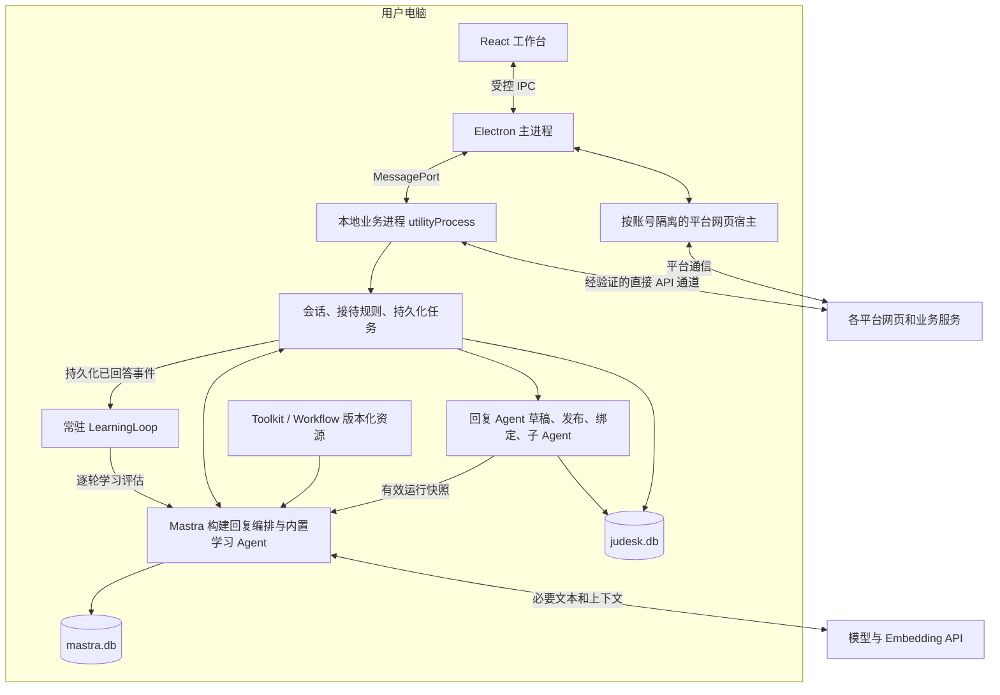

# 技术架构

> Workflow 扩展已移除，本文中与 Workflow 相关的内容仅为历史记录，见[本地扩展开发](extension-development.md#workflow-已移除)。

版本：v0.7  
方案日期：2026-09-07  
状态：已提供拼多多首版实现；实际交付、验证证据与待实测项见[实现与验证记录](implementation-status.md)。

## 1. 架构决策

采用本地模块化单体：同一个安装包发布全部模块，按职责划分进程和代码边界。

业务服务运行在 Electron `utilityProcess` 中；Mastra 通过代码直接调用，使用本地存储和内置工作流执行能力。界面通过 IPC 请求业务操作，主进程管理桌面能力与平台网页宿主。

自动学习开启后，该业务进程常驻 `LearningLoop`，订阅新问题获得实际回答的事件；每轮调度 **内置** `learningAgent` 评估 AI 临场回复或人工作答，并生成待人工审批的知识建议。按问答库原文发出的直答不评估。只有人工批准的具体版本才能进入正式知识和索引。用户编排的 Agent 只用于自动回复，可挂载 Toolkit、Workflow 与子 Agent；学习独立于自动回复开关，且不能被配置台替换。

新增本地 Agent Studio（仅回复编排）、配置发布与回复工作绑定、Toolkit / Workflow / 子 Agent 资源目录和扩展 SDK。借鉴相邻 agent-platform 的草稿、集合工厂与版本设计，单机版采用一个本地配置目录，不引入组织、成员、团队工作区或 AppKey 服务。完整契约见[Agent 配置与高级扩展](agent-customization.md)。

这一路线的依据是 Electron 的 [utilityProcess](https://www.electronjs.org/docs/latest/api/utility-process) 提供 Node.js 和消息端口，Mastra 支持 [Node.js 环境部署](https://mastra.ai/docs/deployment/overview)及代码调用。实际依赖组合仍须通过打包后的验证。



平台适配器可以使用两类传输：网页操作经主进程的网页宿主执行；无需浏览器会话的直接 API 调用可在业务进程执行。两者都必须经过统一适配器和发送控制，不能形成第二条绕过业务状态的发送路径。

## 2. 技术栈与运行环境

| 层次 | 选型 | 使用约定 |
| --- | --- | --- |
| 语言 | TypeScript strict | 进程通信、平台数据、模型输出均做运行时校验 |
| 工具链 | Node.js 24 LTS、pnpm workspace | 提交锁文件；实际安装包使用 Electron 自带 Node |
| 桌面 | Electron | 管理窗口、session、托盘、系统密钥和更新入口 |
| 界面 | React、Tailwind CSS、shadcn/ui | 页面按会话、知识、账号、设置等业务功能组织 |
| 状态 | Zustand、TanStack Query | Zustand 保存交互状态；Query 保存可失效的业务查询缓存 |
| 构建 | electron-vite | 分别构建 main、preload、renderer 和业务进程入口 |
| AI | Mastra | 按回复绑定装配 Agent、Toolkit、Workflow 与子 Agent；学习使用内置 Agent；高阈值直答和审批由业务外层控制 |
| Agent 与扩展配置 | agent-config + extension-sdk | 仅回复侧的草稿、发布、绑定、子 Agent、集合工厂与依赖检查 |
| 业务存储 | Prisma 7.x + LibSQL | 业务进程持有客户端，界面不能直接查询数据库 |
| AI 存储 | LibSQLStore、LibSQLVector | 与业务表分开管理，索引可重建 |
| 校验 | Zod | 在边界处验证类型、长度、枚举和业务上下文 |
| 打包 | electron-builder | 目标系统原生依赖、签名、迁移资源必须进入安装包验证 |
| 测试 | Vitest、Playwright | 优先覆盖状态机、隔离、恢复和真实安装包流程 |

Prisma 采用 7.x 兼容基线，`prisma`、`@prisma/client` 和 `@prisma/adapter-libsql` 作为同一兼容组合固定版本。官方默认文档已转向 Prisma 8，不能使用未固定的 `@latest` 将本文的 7.x API 与 8.x 迁移机制混用；如果改用 8，需要重验 adapter、生成产物和迁移分发。依据见 [Prisma 7 SQLite](https://docs.prisma.io/docs/orm/v7/core-concepts/supported-databases/sqlite) 与 [Prisma 8 迁移](https://www.prisma.io/docs/orm/migrations/applying-a-migration)。

[Node.js 发布记录](https://nodejs.org/en/about/previous-releases)是工具链基线的依据。Mastra 当前文档要求 Node.js 22.13.0 或更高版本；还要综合检查 Prisma、驱动和所选 Electron 的依赖要求。

ESM 作为业务代码的模块组织方向；preload 的输出形式按 Electron 沙箱约束单独配置。不能假定开发机上的 Node.js 版本、模块解析结果或原生驱动可直接等同于安装包运行环境。

## 3. 进程职责

### 3.1 React 工作台

负责统一会话列表、聊天记录、人工输入、独立的自动回复 / 自动学习开关、待人工提醒、**问答库**和账号设置。问答库无需开发者模式：支持本店问答对的列表、新建、编辑、启停，以及含图片的导入 / 导出。展示学习循环运行状态、积压、评估结论、待审批差异和发布结果；支持批准、编辑后批准和拒绝。点进或离开某个会话窗口会通知业务进程更新该会话的打开状态；AI 转人工后的会话要明显标出。业务数据从本地服务查询，收到事件后更新或失效缓存；界面重载后重新查询权威状态。

首次启动采用全屏三步配置页：连接店铺 → 配置模型 → 确认收发并开启接待。基础助手通过受限 IPC 在事务内生成发布版本与店铺绑定，无需先打开开发者模式。进度从业务状态读取，跳过 / 继续偏好保存在 `AppSetting`；已有安装不强制弹出，已有定制配置不覆盖。日常设置按账号与接待、AI 模型、高级定制、数据与备份分组，低频参数默认折叠。详见[首次配置与日常设置](onboarding.md)。

开发者模式默认关闭。关闭时不展示 Agent 配置台与资源目录；设置页在默认回复 Agent 缺失时可一键加回。开启后才提供创建 / 复制 Agent、编辑草稿、调试、发布、历史恢复、选择全局 / 店铺工作版本，以及集合设置、成员 schema 和 JSON 试跑。UI 展示有效版本、继承来源和故障原因，保存草稿与设为工作 Agent 使用不同操作。

模型密钥、数据库客户端、完整 Cookie 和平台执行能力不暴露到 renderer。聊天内容以受控组件渲染，平台返回的 HTML 不直接作为可信界面代码执行。

### 3.2 Electron 主进程

负责应用单实例、主窗口与托盘、系统通知、平台网页创建和销毁、账号 session、受控 IPC、业务进程启动与重启。

主进程还负责操作系统密钥接口、文件选择、安装包更新和暂停接待。业务读写统一交给业务进程；主进程自身不建立第二套业务数据库访问路径。

平台网页根据 [WebContentsView](https://www.electronjs.org/docs/latest/api/web-contents-view) 创建。每个登录身份绑定独立的 `persist:` session 分区，生命周期与标签页显示状态分开管理。用户切换界面标签不能销毁正在接待账号的消息通道。

### 3.3 本地业务进程

启动一个 `utilityProcess`，承载业务模块、Prisma、Mastra、任务消费者、检索与日志，以及一个本地 LearningLoop 协调器。协调器按店铺开关维护独立订阅，按回合调度内置 learningAgent；常驻的是监听与恢复能力，每次模型评估都有明确边界。用户回复编排不进入该循环。

新问题在 conversations 中登记，来自三种回答路径的实际消息统一采集为 AnsweredTurn；回答事务同时写入持久化事件。人工回复确认发送后自动携带当时可见的候选买家消息与会话上下文，不要求客服手动配对；连续文字 / 图片补充按短窗口合并，由内置学习 Agent 在同一次评估中判断对应关系和可复用性，无法确定时不提取。Loop 消费事件并创建学习任务，空闲时等待、有积压时有限并发处理。学习完成后通过 knowledge 模块保存报告和待审批建议，循环继续处理新事件。人工作业审批后，再由发布任务创建正式问答或应用获批修改、安排向量更新，未批准的建议不会改变接待行为。

业务进程还持有 AgentConfigService、AssetRegistry 和 AgentRuntimeFactory：解析回复绑定与子 Agent 闭包，校验已安装集合及设置，生成 RunConfigSnapshot，再创建回复 Mastra 实例。内置学习 Agent 由产品代码装配，不读取 AgentBinding。受信任的本地 Toolkit / Workflow 经 SDK 工厂注册到回复编排；其业务调用统一回到受限宿主接口。

发布冻结 Agent 配置和代码依赖；切换绑定或生效设置递增受影响店铺的角色配置代次。业务任务和发送前复核该代次，不能将一个运行中的实例原地换成新提示词、新工具或新 Workflow。

进程内部用普通模块调用和事件通知协作。CPU 密集型任务以后根据测量结果迁移到 worker；首版优先通过批处理大小、任务优先级和并发限制控制资源。

进程异常退出时，主进程以退避方式重启；连续失败进入可见的故障状态，停止自动接待。重启后先恢复数据库与任务状态，再逐个恢复平台通道。

### 3.4 平台网页宿主

网页宿主保存浏览器会话并执行已登记的操作。使用精确来源校验、导航限制、`nodeIntegration: false`、`contextIsolation: true` 和沙箱设置；IPC 接收端校验 sender、frame 与账号绑定。依据见 [Electron 安全建议](https://www.electronjs.org/docs/latest/tutorial/security)。

平台网页提供的事件均视为外部输入，不能直接取得数据库、文件系统或任意进程通信能力。具体桥接方法随平台实测确定，参见[平台接入设计](platform-adapters.md)。

## 4. 模块与代码结构

建议使用下面的工作区结构，文件夹按实际实现逐步建立：

```text
judesk/
  apps/
    desktop/
      src/
        main/          # 桌面生命周期、网页宿主、IPC、系统能力
        preload/       # 工作台桥接与独立的平台桥接
        renderer/      # React 页面与界面状态
        service/       # utilityProcess 入口与模块装配
  packages/
    contracts/         # IPC、平台事件、DTO、Zod schema
    core/              # accounts、conversations、automation、learning、knowledge
    database/          # Prisma schema、repository、迁移与备份
    platforms/         # 适配接口、各平台实现和脱敏回放样本
    agent-config/      # Agent 草稿、发布、角色绑定、有效配置解析
    extension-sdk/     # manifest、集合工厂、schema、宿主接口与开发测试
    ai/                # Mastra 实例工厂、回复 / 学习总流程、检索与运行记录
  toolkits/
    builtin/           # 内置知识、平台等集合
    local/             # 本地扩展开发示例
  workflows/
    builtin/           # 可挂载给 Agent 的内置流程集合
    local/             # 高级用户流程示例
  docs/
```

依赖规则：

- `contracts` 不依赖 Electron、Prisma、Mastra，内部只放可共享的数据契约。
- `core` 面向存储、平台和 AI 接口编排业务，不导入 Electron API。
- `database` 实现业务存储接口；`replyAgent` 及其子 Agent 通过限定范围的问答检索与已验收平台工具读取或操作资料，发送仍由业务层裁决。内置 `learningAgent` 使用资料查询与候选建议提交接口，不取得审批、正式知识发布、买家发送、平台写操作或用户编排调用权限。
- `platforms` 将外部数据转换为统一事件；需要网页能力时依赖 `BrowserHost` 接口，由主进程实现。
- `agent-config` 管理草稿、发布、绑定和配置解析，依赖存储接口，不启动模型和平台调用；`ai` 根据有效快照构建实例。
- `extension-sdk` 是高级用户接口；集合工厂接受受限上下文，业务数据库、审批入口和账号 Cookie 不作为扩展 API 暴露。Toolkit / Workflow 不能绕过 core 的发送或知识发布控制。
- `desktop/service` 装配实现，连接数据库、平台适配器、资源目录和 Mastra。
- renderer 仅依赖公开 DTO 和界面 API，不把 Prisma 实体类型作为跨进程协议。

业务模块分工如下：

| 模块 | 主要责任 |
| --- | --- |
| accounts | 平台、店铺、客服账号、登录状态、当前接入能力 |
| conversations | 统一消息、会话顺序、未读、当前打开状态、转人工等待与问答回合关联 |
| automation | 自动回复资格、转人工、任务、发送控制、失败恢复 |
| learning | 常驻 Loop、独立开关、已回答事件订阅、逐轮评估任务、幂等恢复与积压 |
| knowledge | 问答库新建 / 编辑 / 导入（含图片）、候选版本、强制人工审批、正式知识发布、修订与索引任务 |
| platforms | 通道连接、收发消息、回执、历史与业务查询 |
| agent-config | 回复 Agent CRUD、草稿冲突检查、发布历史、子 Agent 挂载、回复绑定、店铺覆盖与快照 |
| extensions | 集合目录、安装版本、设置解析、成员校验、试跑、依赖与能力检查 |
| ai | 高阈值直答、回复编排与子 Agent、内置学习 Agent、受限工具调用、评估和运行记录 |

## 5. IPC 与事件约定

应用内部采用请求/响应和事件两种契约，版本从 `1` 开始。以下仅为协议示意：

```ts
type Request<T> = {
  protocolVersion: 1;
  requestId: string;
  method: string;
  payload: T;
};

type Response<T> =
  | { requestId: string; ok: true; data: T }
  | {
      requestId: string;
      ok: false;
      error: { code: string; message: string; retryable: boolean };
    };

type Event<T> = {
  protocolVersion: 1;
  eventId: string;
  type: string;
  revision: number;
  payload: T;
};
```

`method` 在实现中使用登记的字面量联合类型。preload 对界面公开 `listConversations`、`sendManualReply`、`setAutoReplyEnabled`、`setConversationOpened`、`setAutoLearnEnabled`、`listLearningEvaluations`、`approveLearningCandidate`、`editAndApproveLearningCandidate`、`rejectLearningCandidate`，以及 `saveAgentDraft`、`debugAgent`、`publishAgentRevision`、`setAgentBinding`、`listAssets`、`saveAssetSettings`、`testAssetMember` 等明确方法，不公开任意频道调用函数。

每个接收端执行 Zod 校验和账号授权校验。身份范围从已登记的 session 或会话关系获得，不能信任 payload 中自行声明的店铺归属。请求有超时、取消和大小上限；图片通过受控附件引用传递，避免在 IPC 中反复复制大段 Base64。

业务事件在数据库提交之后发送。界面重连或 revision 不连续时重新查询，不能依赖内存事件完成持久化。学习事件 `turn.answered`、`turn.revised`、`turn.invalidated` 与回合状态同事务入库；LearningLoop 通过持久化游标恢复，不依赖界面是否打开。

网页上报事件须等待业务入库确认；主进程在未确认时保留有界缓冲。业务进程停机且缓冲耗尽时，显示通道断档并停止自动回复；恢复完整性依赖已验证的历史补拉能力，不承诺无限缓存或无条件零丢失。

## 6. 启动、退出与恢复

启动顺序：

1. 取得应用单实例锁，确定用户数据目录和应用版本。
2. 启动业务进程，打开数据库，检查迁移和备份状态。
3. 校验数据关系、回复 Agent 发布修订、子 Agent 闭包、回复绑定、资源产物与设置，以及内置学习 Agent 是否可加载；处理上次未完成的发送与任务，此时尚未允许自动发送。缺失回复绑定或扩展只阻止 Agent 回复路径；内置学习不可用只阻止学习任务。人工接待仍可用；符合自身条件的高阈值直答不依赖回复 Agent。
4. 主进程恢复账号 session，与适配器核对实际登录身份。
5. 通道完成能力检查和必要的历史补拉，更新会话归属。
6. 按店铺自动回复开关恢复接待；仍在等待人工的会话不得自动发送。主窗口不可见时清除临时查看 ID，人工接管和转人工等待仍保留。
7. 按独立学习开关恢复 LearningLoop 订阅、事件游标与在途评估。先处理实时接待，再有限并发补处理学习积压；自动回复关闭的店铺也可以恢复学习。
8. 恢复候选与审批记录；待审批继续等待人工，已批准发布任务核对内容和数据版本后恢复，不能通过重启自动批准。关闭学习不阻止已有建议的人工审批。

关闭主窗口默认驻留托盘，并清除临时查看 ID。已开启自动回复且未被人工接管、未等待人工的会话继续由 AI 接待；人工接管和转人工等待保留，必须明确交还 AI，不能因为进入托盘就恢复。学习开启的店铺在托盘驻留时继续运行 LearningLoop。显式退出时停止领新任务，取消尚未发出的 AI 回复，保存学习游标与任务状态并关闭连接。进行中的平台发送必须记录为已确认、确定失败或结果待确认，不能因为退出就记为成功。

休眠恢复、网络恢复和重新登录后都执行通道复核。过期的回复任务重新评估会话上下文，不能直接发送停机前的旧答案。学习任务按保存的问答来源版本恢复，发现补充或纠正时重新评估并生成新候选；旧批准不能用于新内容，也不能覆盖人工已修改的知识。参考 [powerMonitor](https://www.electronjs.org/docs/latest/api/power-monitor)。

## 7. 本地与联网边界

| 内容 | 首版位置与联网方式 |
| --- | --- |
| 业务记录、接待状态、问答回合、学习候选、人工审批与知识原文 | 本地业务库 |
| Agent 草稿 / 修订、工作绑定、集合设置与运行快照 | 本地业务库；密钥只存引用 |
| Toolkit / Workflow 扩展产物 | 用户数据目录内的确切版本；内置资产随应用发布 |
| 向量索引、工作流状态、调用诊断 | 本地 AI 库，按保留策略清理 |
| 附件、备份 | 本地用户数据目录或用户选择的导出目录 |
| 账号登录与消息收发 | 直接连接平台，通道随平台验证确定 |
| LLM 与 Embedding | 由业务进程调用用户配置的服务，仅传必要资料 |
| 软件更新 | 后续可连接静态发布源；不承载客服业务数据 |
| 远程日志与云观测 | 首版默认关闭，诊断导出由用户触发并脱敏 |

模型 Key 使用 [safeStorage](https://www.electronjs.org/docs/latest/api/safe-storage) 的操作系统加密能力，明文仅在所需进程内短暂使用。该能力保护密钥存储，并不自动加密全部数据库；完整业务库加密需单独设计、验证和管理密钥恢复。

应用自用模型凭据由用户配置，不在安装包中内置所有用户共用的生产密钥。需要服务端保密的第三方应用凭据也不能通过混淆或加密常量视为已解决。

## 8. 扩展条件与架构取舍

本地方案适合一台常开电脑管理多店铺。常驻网页数量、模型并发、历史量和向量规模的上限由实测给出，不能从数据库引擎名称推断可承载的店铺数。

需要多电脑协作时，增加局域网主机或远程业务服务，统一账号通道归属、会话接管与任务执行。业务库可迁移 PostgreSQL，向量改用 pgvector；必须实施数据迁移和索引重建，不是仅更换连接字符串。

本地配置台与高级扩展不需要组织和多租户后端，也不要求启动 agent-platform 的 API 服务。受信任本地扩展先在业务 utilityProcess 中加载；独立进程可隔离界面故障，但不构成对任意 JavaScript 的强沙箱。扩展 SDK、代码加载和恢复边界见[扩展设计](agent-customization.md#6-目录加载与版本兼容)。

首版不引入独立 Web 后端、Redis 或分布式消息队列。平台若要求公网回调，则作为特定接入通道的新增依赖记录下来。它不能被描述成仍然满足完全零后端的承诺。

## 9. 资料依据

- [相邻 agent-platform 的参考代码与取舍](agent-customization.md#11-agent-platform-中已核对的设计)

- [Electron utilityProcess](https://www.electronjs.org/docs/latest/api/utility-process)
- [Electron session](https://www.electronjs.org/docs/latest/api/session)
- [Electron WebContentsView](https://www.electronjs.org/docs/latest/api/web-contents-view)
- [Electron 安全建议](https://www.electronjs.org/docs/latest/tutorial/security)
- [Electron safeStorage](https://www.electronjs.org/docs/latest/api/safe-storage)
- [Mastra 部署与运行环境](https://mastra.ai/docs/deployment/overview)
- [Mastra 手动集成](https://mastra.ai/reference/manual-install)
- [Node.js 发布记录](https://nodejs.org/en/about/previous-releases)

以上资料用于确认框架能力；本项目的职责分配、状态机和发布流程属于本方案设计，须按验收计划实现。
